# Introduction

[Quarto](https://quarto.org) est un système de publication open source qui permet
de créer des documents techniques (HTML, PDF, slides) à partir de fichiers texte
simples au format `.qmd`.

Dans ce cours, vous l'utiliserez pour rédiger votre documentation d'administration
système avec des **blocs de commandes facilement copiables**.

---

## 1. Installation de Quarto

Rendez-vous sur **<https://quarto.org/docs/get-started/>** et téléchargez
l'installateur correspondant à votre système.

::: {.panel-tabset}

### Windows

1. Télécharger l'installateur `.msi` depuis [quarto.org](https://quarto.org/docs/get-started/)
2. Lancer l'installateur et suivre les étapes
3. Vérifier l'installation dans un terminal :

```powershell
quarto --version
```

### macOS

Avec Homebrew (recommandé) :

```bash
brew install --cask quarto
```

Ou télécharger le `.pkg` depuis [quarto.org](https://quarto.org/docs/get-started/).

Vérifier :

```bash
quarto --version
```

### Linux (Debian/Ubuntu)

```bash
# Télécharger le paquet .deb
curl -LO https://quarto.org/download/latest/quarto-linux-amd64.deb

# Installer
sudo dpkg -i quarto-linux-amd64.deb

# Vérifier
quarto --version
```

:::

---

## 2. VS Code — Éditeur recommandé

### 2.1 Installer VS Code

Télécharger depuis **<https://code.visualstudio.com/>**

### 2.2 Extensions indispensables

Installer ces extensions depuis le panneau Extensions de VS Code (`Ctrl+Shift+X`) :

| Extension | Rôle |
|---|------|
| **Quarto** | Support `.qmd`, preview intégré |
| **YAML** | Validation du YAML en-tête |
| **LTex+ / Spell Checker** | Correcteur orthographique |


### 2.3 Preview dans VS Code

Une fois l'extension Quarto installée, ouvrir un fichier `.qmd` et cliquer sur
le bouton **Preview** en haut à droite, ou utiliser le raccourci :

```
Ctrl+Shift+K   (Windows/Linux)
Cmd+Shift+K    (macOS)
```

---

## 3. Vérification finale

Dans un terminal, depuis le dossier de votre projet :

```bash
# Vérifier que tout est en place
quarto check

# Prévisualiser votre document
quarto preview mon_document.qmd

# Générer le HTML final
quarto render mon_document.qmd
```

Si `quarto check` affiche des erreurs, relire les étapes correspondantes
ci-dessus ou consulter <https://quarto.org/docs/troubleshooting/>.

---

# Get Started - Exemples Markdown

## Diagramme (Mermaid)

Exemple d'architecture trois tiers — **modifiez selon votre projet** :

```{mermaid}
graph TD
    U([Utilisateur]) --> FW[Pare-feu]
    FW --> LB[Load Balancer\nnginx]
    LB --> WEB1[Serveur Web 1\nApache]
    LB --> WEB2[Serveur Web 2\nApache]
    WEB1 --> APP[Serveur Applicatif\nNode.js]
    WEB2 --> APP
    APP --> DB[(Base de données\nPostgreSQL)]
    APP --> CACHE[(Cache\nRedis)]

    style FW fill:#f96,stroke:#333
    style DB fill:#69b,stroke:#333,color:#fff
    style CACHE fill:#69b,stroke:#333,color:#fff
```

Autres exemples de diagrammes utiles en admin sys :

**Flux réseau :**

```{mermaid}
sequenceDiagram
    participant C as Client
    participant F as Pare-feu
    participant S as Serveur

    C->>F: Requête HTTP (port 80)
    F->>S: Transfert (port 8080)
    S-->>F: Réponse 200 OK
    F-->>C: Réponse
```

**Pipeline de déploiement :**

```{mermaid}
flowchart LR
    A[git push] --> B[CI/CD]
    B --> C{Tests OK ?}
    C -- Oui --> D[Build image Docker]
    C -- Non --> E[Notification échec]
    D --> F[Push registry]
    F --> G[Deploy production]
```

---

## Capture d'écran / Schéma

Pour insérer une image (capture d'écran, schéma Dia, draw.io exporté...) :

```markdown
{width=80%}
```


Placer vos images dans un dossier `images/` à côté du `.qmd`.


::: {.callout-tip}
**Outils gratuits pour créer vos schémas :**

- [draw.io](https://draw.io) — en ligne, export PNG/SVG
- [Excalidraw](https://excalidraw.com) — style tableau blanc
- Mermaid directement dans le `.qmd` (pas besoin d'image !)
:::

---

## Mise en forme de base

### Texte

- **Gras** : `**texte**`
- *Italique* : `*texte*`
- `Code inline` : `` `commande` ``
- ~~Barré~~ : `~~texte~~`
- [Lien](https://quarto.org) : `[texte](url)`

> **Note :** les blocs de citation sont utiles pour les remarques importantes.

---

### Listes

**Liste à puces :**

- Premier élément
- Deuxième élément
  - Sous-élément
  - Sous-élément
- Troisième élément

**Liste numérotée :**

1. Première étape
2. Deuxième étape
3. Troisième étape

---

### Tableaux

| Commande | Description | Exemple |
|---|---|---|
| `ls` | Lister les fichiers | `ls -la /etc` |
| `cd` | Changer de dossier | `cd /var/log` |
| `cat` | Afficher un fichier | `cat /etc/hosts` |
| `grep` | Rechercher dans un fichier | `grep "error" syslog` |

---

## Blocs de code

### Commande simple

```bash
sudo apt-get update && sudo apt-get upgrade -y
```

### Procédure complète

```bash
# Installer nginx
sudo apt-get install -y nginx

# Démarrer et activer au boot
sudo systemctl start nginx
sudo systemctl enable nginx

# Vérifier le statut
sudo systemctl status nginx
```

### Fichier de configuration

```nginx
# /etc/nginx/sites-available/mon-site
server {
    listen 80;
    server_name exemple.com;

    root /var/www/html;
    index index.html;

    location / {
        try_files $uri $uri/ =404;
    }
}
```

### Sortie de commande

```
● nginx.service - A high performance web server
     Loaded: loaded (/lib/systemd/system/nginx.service)
     Active: active (running) since Mon 2024-01-01 10:00:00 UTC
```

---

## Callouts

::: {.callout-note}
**Note :** Information complémentaire utile mais non critique.
:::

::: {.callout-tip}
**Astuce :** Conseil pour aller plus vite ou mieux faire.
:::

::: {.callout-warning}
**Attention :** Action à risque, vérifier avant d'exécuter.
:::

::: {.callout-important}
**Important :** À lire absolument avant de continuer.
:::

::: {.callout-caution}
**Danger :** Commande destructrice, sauvegardez d'abord !

```bash
# NE PAS exécuter sans sauvegarde préalable
rm -rf /var/www/html/*
```
:::

---

## Procédure pas à pas — exemple

### Prérequis

- Système : Ubuntu 24.04 LTS
- Accès `sudo`
- Connexion internet

### Étape 1 — Mise à jour du système

```bash
sudo apt-get update
sudo apt-get upgrade -y
```

### Étape 2 — Installation

```bash
sudo apt-get install -y nom-du-paquet
```

### Étape 3 — Configuration

```bash
sudo nano /etc/nom-du-service/config.conf
```

```ini
[general]
option1 = valeur1
option2 = valeur2
```

### Étape 4 — Activation

```bash
sudo systemctl daemon-reload
sudo systemctl enable --now nom-du-service
```

### Vérification

```bash
sudo systemctl status nom-du-service
```

::: {.callout-tip}
Si le service ne démarre pas, consulter les logs :

```bash
sudo journalctl -u nom-du-service -f
```
:::

---

## Ressources supplémentaires

- [Documentation officielle](https://quarto.org/docs/guide)
- [Guide Markdown](https://quarto.org/docs/authoring/markdown-basics.html)
- [Galerie d'exemples](https://quarto.org/docs/gallery/)
- [Guide Quarto Markdown](https://quarto.org/docs/authoring/markdown-basics.html)
- [Éditeur de diagrammes Mermaid](https://mermaid.live)
