****

---

## Introduction

### Objectif

Ce projet met en place un **chatbot fonctionnant entièrement en local**, dans une machine virtuelle Debian 13 sous VirtualBox. Un utilisateur ouvre `https://chatbot.local` dans son navigateur, se connecte avec un compte, pose une question, et un modèle de langage installé sur la VM lui répond, sans que les questions soient envoyées à un service d'IA externe.

La solution assemble quatre briques :

| Brique | Rôle |
|---|---|
| **Ollama** | Moteur qui charge le modèle de langage `llama3.2:1b` et répond via une API HTTP (port 11434) |
| **Open WebUI** | Interface web de type ChatGPT (comptes, historique, zone de discussion), exécutée dans un conteneur **Docker** |
| **Nginx** | Reverse proxy : seule porte d'entrée, qui reçoit les connexions en HTTPS et les transmet à Open WebUI |
| **nftables** | Pare-feu qui bloque tous les ports entrants sauf ceux réellement utilisés |

### Contexte et problématique

Les assistants conversationnels en ligne envoient chaque question vers les serveurs d'un fournisseur externe. Pour une entreprise, ça pose un vrai problème de **confidentialité**, puisque des documents internes, des données clients ou du code source peuvent sortir du réseau. Un modèle de langage hébergé sur un serveur interne règle ce problème, même si ses performances sont plus modestes, surtout sans carte graphique.

Rendre ce service accessible pose ensuite des questions classiques d'administration système. Ollama n'a **aucune authentification**, donc toute personne qui atteint son port 11434 peut utiliser le modèle. Et si Open WebUI était exposé directement, il serait servi en HTTP, avec les mots de passe et les conversations en clair sur le réseau. Notre architecture règle ces deux points. Seul Nginx est joignable, en HTTPS. Open WebUI n'écoute qu'en local et demande une connexion. Enfin, le pare-feu empêche d'atteindre Ollama directement. On applique ainsi la règle de sécurité de base vue dans le syllabus (section 2.6), qui consiste à bloquer sur le serveur tous les ports sauf ceux des applications utilisées.

Le projet met aussi en œuvre plusieurs notions du cours :

| Notion du syllabus | Mise en œuvre dans le projet |
|---|---|
| 2.5.1 Adresses spéciales | Open WebUI publié sur la boucle locale `127.0.0.1` ; réseau privé `192.168.56.0/24` |
| 2.6 Ports et politique de sécurité | Ports 22, 80 et 443 seuls ouverts depuis la machine hôte |
| 3.3.2 Résolution d'un nom | Nom `chatbot.local` déclaré dans le fichier `hosts` de la machine hôte |
| 3.4 DHCP et 3.5 NAT | Carte NAT de VirtualBox, adresse obtenue par DHCP pour l'accès Internet |
| 5.4 SSH et 5.4.7 tunnel SSH | Administration à distance, puis accès temporaire à Open WebUI par tunnel avant la mise en place de Nginx |
| 6.7 Reverse proxy et 6.9.2 certificat auto-signé | Même principe, appliqué avec Nginx au lieu d'Apache |
| 10.8 Snapshots et 10.8.1.3 réseau host-only | Un snapshot par phase ; carte host-only pour joindre la VM depuis la machine hôte |
| 11.2 Docker | Open WebUI déployé dans un conteneur, données conservées dans un volume |

### Éléments inédits

Par rapport au cours, les éléments suivants sont totalement nouveaux :

- **Un modèle de langage local avec Ollama.** Le cours n'aborde ni les modèles de langage ni leur hébergement. Nous avons installé Ollama comme service systemd, choisi un modèle adapté à une VM sans GPU (`llama3.2:1b`, 1 milliard de paramètres) et interrogé son API HTTP.
- **Nginx comme reverse proxy.** Le syllabus le cite comme alternative à Apache (section 6.2), mais les exercices utilisent Apache. Nous avons donc écrit une configuration Nginx complète, avec la redirection HTTP vers HTTPS, la terminaison TLS, le passage des **WebSockets** (utilisés par Open WebUI pour sa connexion en temps réel avec le navigateur), la transmission des réponses en flux et un délai d'attente allongé à 300 s pour laisser au modèle le temps de commencer à répondre.
- **Un pare-feu avec nftables.** Le cours énonce le principe « tout bloquer sauf les ports utilisés », mais ne présente pas d'outil de pare-feu. Nous avons écrit des règles nftables qui cohabitent avec celles que Docker crée lui-même, en évitant la directive `flush ruleset` qui les effacerait.
- **La communication entre un conteneur et un service de la VM.** Pour qu'Open WebUI atteigne Ollama, il a fallu comprendre que `127.0.0.1` désigne le conteneur lui-même et non la VM, modifier l'adresse d'écoute d'Ollama par un fichier de surcharge systemd, puis restreindre le port 11434 à l'interface Docker `docker0` dans le pare-feu.

### Environnement utilisé

La procédure de ce document a été réalisée sur un PC **Windows**, avec VirtualBox. Les commandes à taper sur la machine hôte sont donc données pour PowerShell, et les captures viennent de ce PC.

Deux membres du groupe ont aussi refait l'installation sur **Mac**, avec une VM en ARM. La plupart des commandes sont les mêmes, puisqu'elles se tapent dans la VM Debian. Quand quelque chose change sur Mac, un encadré « Sur Mac » indique quoi modifier à cet endroit de la procédure (noms des cartes réseau, architecture ARM, commandes du Terminal, fichier hosts).


## Configuration réseau VirtualBox

### VM créée

**Logiciels utilisés :** VirtualBox **7.2.16** sous Windows, et l'image d'installation `debian-13.7.0-amd64-netinst.iso` téléchargée sur debian.org (sur Mac, il faut la version `arm64` de la même image).

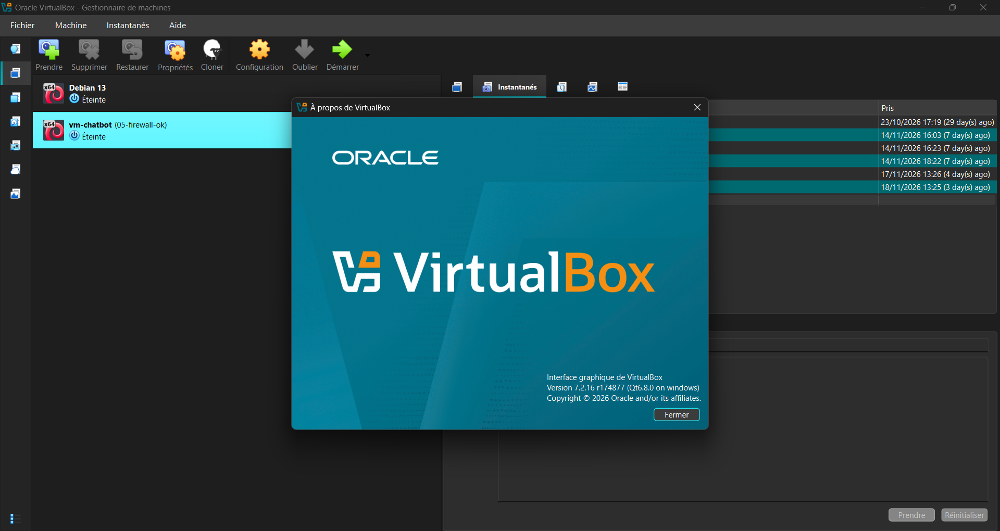{width=70%}

**Création de la VM dans VirtualBox** (**Machine → Nouvelle**) :

| Nom de la VM | Type | RAM allouée | Processeurs | Disque |
|---|---|---|---|---|
| vm-chatbot | Linux, Debian (64-bit) | 8192 Mo | 4 | VDI de 40 Gio à allocation dynamique (`vm-chatbot.vdi`) |

À allocation dynamique, le fichier du disque ne prend de la place sur la machine hôte qu'au fur et à mesure qu'on écrit dedans (voir le problème 3).

**Choix faits dans l'installeur Debian :**

| Étape de l'installeur | Choix | Remarque |
|---|---|---|
| Nom de machine | `chatbot10` | Différent du nom `vm-chatbot` donné dans VirtualBox. C'est ce nom qui apparaît dans l'invite `chatbot10@chatbot10` |
| Mot de passe root | Défini | Debian n'installe alors pas `sudo`. C'est pour cela qu'on passe par `su -` puis qu'on installe `sudo` à la main plus loin |
| Utilisateur | `chatbot10` | Utilisé pour toutes les connexions SSH |
| Interface réseau principale | `enp0s3` | La carte NAT, la seule que l'installeur configure |
| Logiciels | Utilitaires usuels du système, **sans** environnement graphique et **sans** serveur SSH | La VM est un serveur sans écran, et le serveur SSH est installé ensuite à la main |

::: {.callout-tip}
**📷 Capture :** page Détails de la VM dans VirtualBox.

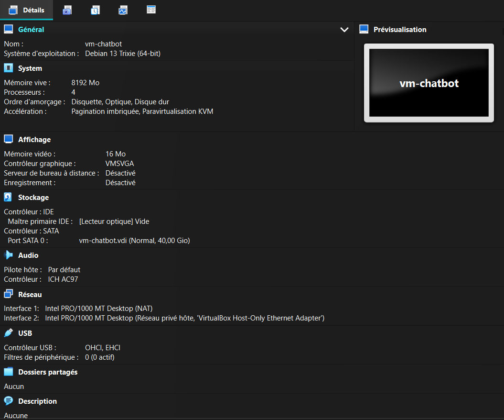{width=90%}
:::

### Interfaces réseau VirtualBox

La VM dispose de **deux interfaces réseau** dans VirtualBox, toutes deux de type Intel PRO/1000 MT Desktop :

| Interface VirtualBox | Nom dans Debian | Type VirtualBox | Rôle |
|---|---|---|---|
| Interface 1 | `enp0s3` | NAT | Accès Internet (apt, Docker, téléchargement du modèle) |
| Interface 2 | `enp0s8` | Réseau privé hôte (host-only), `VirtualBox Host-Only Ethernet Adapter` | Communication entre la machine hôte et la VM (SSH, HTTPS) |

::: {.callout-note}
**Pourquoi deux cartes ?** Le NAT donne Internet à la VM, mais la machine hôte ne peut pas la joindre par ce réseau (sans redirection de ports). Le réseau privé hôte (host-only) crée le réseau `192.168.56.0/24`, partagé entre la VM et la machine hôte. C'est par lui que passent le SSH et l'accès au chatbot depuis le navigateur.

**Réglage VirtualBox :** Configuration de la VM → Réseau → Interface 2 → Réseau privé hôte → `VirtualBox Host-Only Ethernet Adapter`.
:::

Si le réseau privé hôte n'existe pas encore, on le crée dans VirtualBox avec **Fichier → Outils → Réseau**, onglet **Host-only Networks**, bouton **Créer**. On vérifie ensuite que son préfixe IPv4 est bien `192.168.56.1/24`.

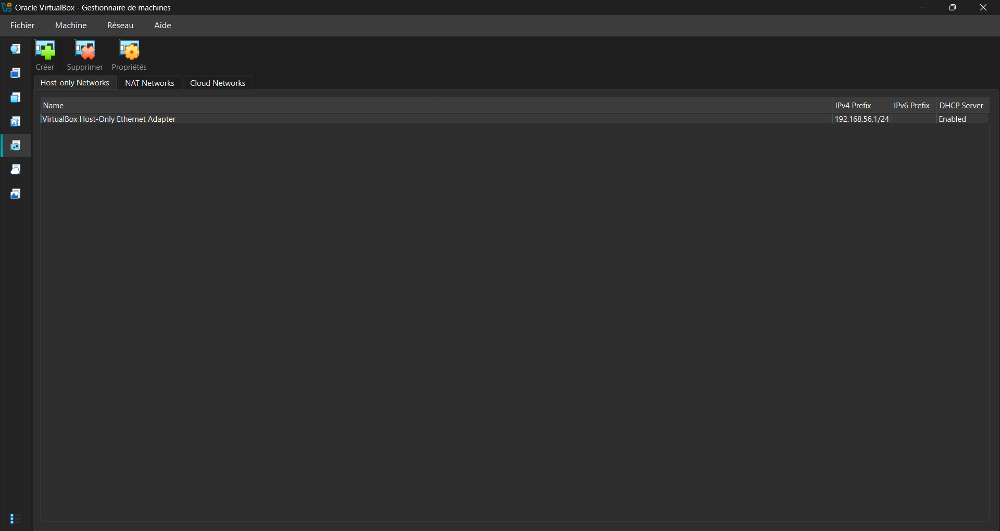{width=90%}

::: {.callout-note}
**Sur Mac (VM en ARM)**, les cartes réseau n'ont pas le même nom dans Debian. Sur nos Mac, la carte NAT s'appelle `enp0s8` et la carte host-only `enp0s9`. On le vérifie avec `ip -br addr` avant de commencer. Dans toute la suite, il faut donc remplacer `enp0s8` par `enp0s9`, et `enp0s3` par `enp0s8`. Les encadrés « Sur Mac » indiquent à chaque fois ce qui change.
:::

### Plan d'adressage

| Machine | Interface | IP | Masque | Remarque |
|---|---|---|---|---|
| vm-chatbot | `enp0s3` | 10.0.2.15 | /24 | Attribuée automatiquement par VirtualBox (DHCP du NAT) |
| vm-chatbot | `enp0s8` | 192.168.56.10 | /24 | IP fixe — point d'entrée SSH et HTTPS |
| vm-chatbot | `docker0` | 172.17.0.1 | /16 | Créée par Docker à son installation. C'est l'adresse derrière `host.docker.internal` (voir *Lancement d'Open WebUI*) |
| Machine hôte | `VirtualBox Host-Only Ethernet Adapter` | 192.168.56.1 | /24 | Attribuée automatiquement par VirtualBox |

### État initial de la VM

Après l'installation de Debian 13 (installation minimale, sans environnement graphique), on relève l'état de la VM avant toute configuration.

```bash
# Sur vm-chatbot (console VirtualBox)
hostname
# → chatbot10

ip -br addr
# → lo               UNKNOWN        127.0.0.1/8 ::1/128
# → enp0s3           UP             10.0.2.15/24 ...
# → enp0s8           DOWN

systemctl is-active ssh
# → inactive
```

La carte NAT (`enp0s3`) a reçu son adresse automatiquement, mais la carte host-only (`enp0s8`) est inactive et n'a pas d'adresse, car l'installeur Debian ne configure que la première carte réseau. Le serveur SSH n'est pas actif non plus. On règle ces deux points dans les étapes suivantes.

::: {.callout-tip}
**📷 Capture :** état initial de la VM.

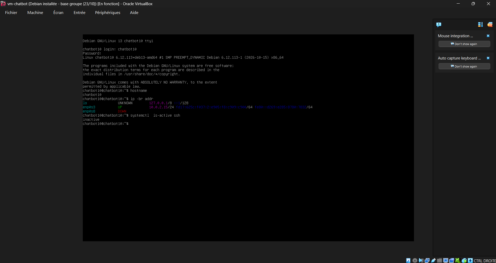{width=90%}
:::

### Configuration de l'IP fixe

**Pourquoi :** tant que la carte host-only n'a pas d'adresse, la machine hôte ne peut pas joindre la VM. On lui donne une adresse **fixe** pour qu'elle ne change jamais, parce que le fichier hosts, le certificat TLS et toute cette documentation reposent sur `192.168.56.10`.

**Sur vm-chatbot** (console VirtualBox) :

```bash
# Passer en root (mot de passe root défini à l'installation)
su -

# Ouvrir le fichier de configuration réseau
nano /etc/network/interfaces
```

Ajouter à la fin du fichier, sans toucher à la configuration existante de `enp0s3` :

```text
auto enp0s8
iface enp0s8 inet static
    address 192.168.56.10/24
```

| Ligne | Rôle |
|---|---|
| `auto enp0s8` | Active la carte automatiquement à chaque démarrage |
| `iface enp0s8 inet static` | Adresse IPv4 fixe, saisie à la main (à l'inverse de `dhcp`) |
| `address 192.168.56.10/24` | Adresse de la VM sur le réseau host-only `192.168.56.0/24` |

On ne définit pas de passerelle (`gateway`) sur cette carte, puisque l'accès à Internet continue de passer par la carte NAT.

```bash
# Activer la carte immédiatement, sans redémarrer
ifup enp0s8
```

**Vérification (sur vm-chatbot) :** le fichier contient la nouvelle configuration, et `enp0s8` est active avec l'adresse attendue.

```bash
cat /etc/network/interfaces
# → # The primary network interface
# → allow-hotplug enp0s3
# → iface enp0s3 inet dhcp
# → # This is an autoconfigured IPv6 interface
# → iface enp0s3 inet6 auto
# → auto enp0s8
# → iface enp0s8 inet static
# →         address 192.168.56.10/24

ip -br addr
# → lo               UNKNOWN        127.0.0.1/8 ::1/128
# → enp0s3           UP             10.0.2.15/24 ...
# → enp0s8           UP             192.168.56.10/24 ...
```

::: {.callout-tip}
**📷 Capture :** configuration de `enp0s8` et adresse obtenue.

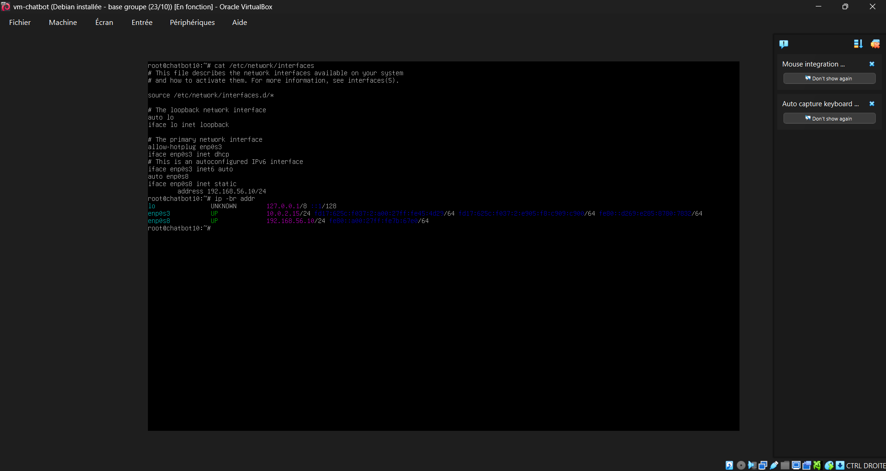{width=90%}
:::

::: {.callout-note}
**Sur Mac**, on configure la carte host-only `enp0s9` au lieu de `enp0s8` :

```text
auto enp0s9
iface enp0s9 inet static
    address 192.168.56.10/24
```

puis on l'active avec `ifup enp0s9`.
:::

### Installation du serveur SSH et de sudo

**Pourquoi :** le serveur SSH permet d'administrer la VM depuis un terminal de la machine hôte, avec le copier-coller des commandes, plutôt que dans la console VirtualBox. `sudo` permet à l'utilisateur `chatbot10` de lancer une commande en administrateur sans ouvrir de session root. Toutes les étapes suivantes l'utilisent.

**Sur vm-chatbot** (console VirtualBox), toujours dans la session root ouverte avec `su -` :

```bash
# Mettre à jour la liste des paquets, puis installer les deux programmes
apt update
apt install -y openssh-server sudo

# Donner le droit d'utiliser sudo à l'utilisateur chatbot10
usermod -aG sudo chatbot10

# Quitter la session root
exit
```

Comme pour tout changement de groupe, le droit `sudo` ne s'applique qu'à la connexion suivante, donc ici à partir de la connexion SSH de l'étape suivante.

**Vérification (sur vm-chatbot) :** le service SSH, inactif à l'état initial, est maintenant actif, et `chatbot10` fait partie du groupe `sudo`.

```bash
systemctl is-active ssh
# → active

groups chatbot10
# → chatbot10 : chatbot10 cdrom floppy sudo audio dip video plugdev users netdev bluetooth
```

::: {.callout-tip}
**📷 Capture :** service SSH actif et groupes de l'utilisateur.

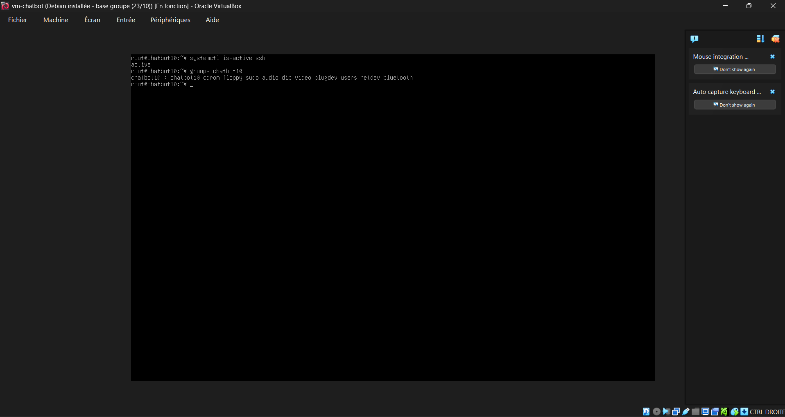{width=90%}
:::

### Vérification de la connectivité

**Pourquoi :** avant d'installer quoi que ce soit, on vérifie les liaisons dont le projet a besoin. La machine hôte doit pouvoir joindre la VM (en SSH maintenant, en HTTPS plus tard), et la VM doit pouvoir joindre Internet et résoudre les noms de domaine pour télécharger les paquets, Docker et le modèle.

**Depuis la machine hôte** (PowerShell), on vérifie que la VM répond sur le réseau host-only.

```powershell
ping 192.168.56.10
# → Réponse de 192.168.56.10 : octets=32 temps<1ms TTL=64
# → Paquets : envoyés = 4, reçus = 4, perdus = 0 (perte 0%)
```

::: {.callout-tip}
**📷 Capture :** ping de la machine hôte vers la VM.

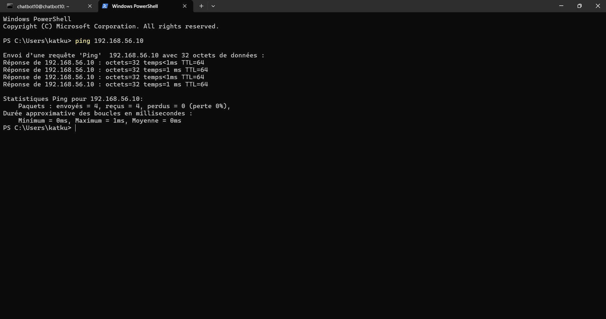{width=90%}
:::

::: {.callout-note}
**Sur Mac**, les commandes se tapent dans le Terminal au lieu de PowerShell. `ping` ne s'arrête pas tout seul comme sous Windows, il faut donc lui dire combien de paquets envoyer, avec `ping -c 4 192.168.56.10`. Les commandes `ssh` et `ssh-keygen` sont les mêmes.
:::

**Depuis la machine hôte**, on se connecte en SSH à la VM.

```powershell
ssh chatbot10@192.168.56.10
# → Are you sure you want to continue connecting (yes/no/[fingerprint])? yes
# → Warning: Permanently added '192.168.56.10' (ED25519) to the list of known hosts.
# → chatbot10@192.168.56.10's password:
# → chatbot10@chatbot10:~$
```

À la première connexion, SSH affiche l'empreinte de la VM et demande de la confirmer. Avant de taper `yes`, on compare cette empreinte avec celle de la VM, affichée dans la console VirtualBox. Si les deux sont identiques, on se connecte bien à notre VM.

```bash
# Sur vm-chatbot (console VirtualBox)
ssh-keygen -lf /etc/ssh/ssh_host_ed25519_key.pub
# → 256 SHA256:NqfKR9P/aX+jd0ZA77ONzHT62ftNAaAiDedb2L4qLbk root@chatbot10 (ED25519)
```

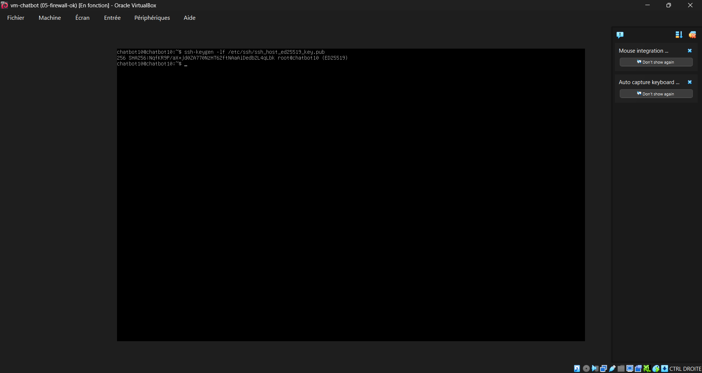{width=90%}

Si un avertissement `REMOTE HOST IDENTIFICATION HAS CHANGED` apparaît à la place, voir le problème 1 de la section « Problèmes rencontrés ».

À partir de cette étape, toutes les commandes « sur vm-chatbot » sont saisies dans cette session SSH.

**Sur vm-chatbot** (session SSH) :

```bash
# Qui est connecté, et depuis quelle adresse ?
who
# → chatbot10 sshd pts/0   2026-11-14 15:45 (192.168.56.1)

# sudo fonctionne-t-il pour chatbot10 ?
sudo whoami
# → root

# La VM joint-elle Internet (carte NAT) ?
ping -c 3 8.8.8.8
# → 3 packets transmitted, 3 received, 0% packet loss, time 2153ms
# → rtt min/avg/max/mdev = 5.654/6.257/6.871/0.496 ms

# La résolution DNS fonctionne-t-elle ?
getent ahostsv4 deb.debian.org
# → 151.101.194.132 STREAM debian.map.fastlydns.net
# → 151.101.2.132   STREAM
# → 151.101.66.132  STREAM
# → 151.101.130.132 STREAM
```

| Vérification | Résultat |
|---|---|
| Ping hôte → VM | 4 paquets sur 4 reçus, 0 % de perte |
| Connexion SSH hôte → VM | Réussie ; `who` montre la session ouverte depuis `192.168.56.1`, l'adresse de la machine hôte sur le réseau host-only |
| Droits administrateur | `sudo whoami` renvoie `root` |
| Accès Internet de la VM | 3 paquets sur 3 reçus, 0 % de perte |
| Résolution DNS | `deb.debian.org` résolu en quatre adresses IPv4 |

::: {.callout-tip}
**📷 Capture :** vérifications depuis la session SSH.

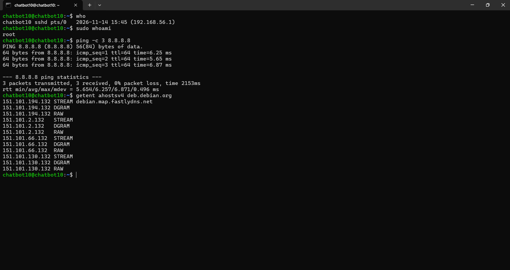{width=90%}
:::

::: {.callout-tip}
**Snapshot conseillé :** l'environnement réseau fonctionne, prendre le snapshot `01-debian-reseau-ok` avant de passer à l'installation.

Dans VirtualBox, avec la VM éteinte (`sudo poweroff`), on sélectionne `vm-chatbot`, puis l'onglet **Instantanés** → **Prendre**, et on donne un nom. Pour revenir à cet état plus tard, il suffit de sélectionner le snapshot et de cliquer sur **Restaurer**.
:::


## Architecture

### Schéma d'architecture

Toute la solution tient sur une seule VM. Le schéma montre les flux réseau, de la machine hôte jusqu'au modèle, ainsi que les ports ouverts à chaque étape.

```{mermaid}
flowchart TD
    H(["Machine hôte Windows<br/>192.168.56.1<br/>navigateur, PowerShell"])
    I[("Internet")]
    subgraph HO["host-only 192.168.56.0/24"]
        subgraph VM["vm-chatbot 192.168.56.10"]
            FW{{"Pare-feu nftables<br/>entrée autorisée : 22, 80, 443 sur enp0s8<br/>11434 sur docker0"}}
            S["OpenSSH<br/>:22"]
            N["Nginx<br/>:80 redirection 301<br/>:443 HTTPS"]
            subgraph DK["docker0 172.17.0.1/16"]
                W["Conteneur open-webui<br/>:8080, publié sur 127.0.0.1:3000"]
            end
            O["Ollama<br/>:11434<br/>modèle llama3.2:1b"]
            NAT["Carte NAT enp0s3<br/>10.0.2.15"]
        end
    end
    H -->|"SSH :22"| FW
    H -->|"HTTPS :443, HTTP :80"| FW
    FW --> S
    FW --> N
    N -->|"HTTP 127.0.0.1:3000"| W
    W -->|"HTTP host.docker.internal:11434<br/>(172.17.0.1, via docker0)"| O
    NAT -.->|"apt, image Docker, modèle<br/>à l'installation uniquement"| I
```

Le seul point d'entrée du chatbot est Nginx, en HTTPS. Open WebUI n'écoute que sur `127.0.0.1`, et Ollama n'est joignable que depuis les conteneurs, grâce au pare-feu. La carte NAT ne sert qu'à l'installation (paquets Debian, image Docker, modèle). Le chatbot fonctionne sans elle, comme le montre le test hors ligne.

### Tableau des composants

| Composant | VM | IP | Port(s) | Rôle |
|---|---|---|---|---|
| OpenSSH | vm-chatbot | 192.168.56.10 | 22 | Administration à distance, depuis le réseau host-only |
| Nginx 1.26.3 | vm-chatbot | 192.168.56.10 | 80, 443 | Reverse proxy, HTTPS, redirection HTTP vers HTTPS. Seul point d'entrée du chatbot |
| Open WebUI v0.13.3 | vm-chatbot (conteneur Docker `open-webui`) | 127.0.0.1 | 3000 (8080 dans le conteneur) | Interface web, comptes, historique. Joignable seulement depuis la VM, par Nginx |
| Ollama 0.40.16 | vm-chatbot | 0.0.0.0, filtré par le pare-feu | 11434 | Charge le modèle et génère les réponses. Joignable seulement depuis les conteneurs, via `docker0` (172.17.0.1) |
| Volume `open-webui` | vm-chatbot (Docker) | — | — | Conserve comptes et conversations quand le conteneur est recréé |
| llama3.2:1b | vm-chatbot (fichiers d'Ollama) | — | — | Modèle de langage de 1,3 Go |
| nftables | vm-chatbot (noyau) | — | — | Bloque tout le trafic entrant non autorisé |

## Diagramme au choix

Nous avons choisi un **diagramme de séquence** qui suit une question, du navigateur jusqu'au modèle. Le schéma d'architecture montre *qui parle à qui*, alors que ce diagramme montre *dans quel ordre* les échanges se font et ce que chaque composant fait de la requête.

```{mermaid}
sequenceDiagram
    autonumber
    actor U as Navigateur (hôte)
    participant F as nftables
    participant N as Nginx :443
    participant W as Open WebUI 127.0.0.1:3000
    participant O as Ollama :11434

    U->>F: Requête HTTPS vers 192.168.56.10:443
    F->>N: Acceptée (enp0s8, port 443)
    N->>N: Déchiffrement TLS (certificat chatbot.local)
    alt Conteneur open-webui en marche
        N->>W: Requête HTTP ou WebSocket (en-têtes X-Forwarded-*)
        W->>W: Vérification de la session
        W->>O: POST /api/chat, modèle llama3.2:1b (via docker0, autorisé)
        O->>O: Chargement du modèle en mémoire si nécessaire
        loop Génération mot par mot
            O-->>W: Morceau de réponse
            W-->>N: Morceau de réponse
            N-->>U: Morceau de réponse, transmis sans attendre la fin
        end
    else Conteneur arrêté
        N-->>U: 502 Bad Gateway
    end
```

**Lecture du diagramme :**

- **Étapes 1 à 3.** Le pare-feu laisse passer la requête parce qu'elle arrive sur `enp0s8`, port 443. Nginx déchiffre ensuite la connexion. Le chiffrement s'arrête donc à Nginx, et la suite du trajet se fait en HTTP, mais à l'intérieur de la VM.
- **Étapes 4 et 5.** Nginx transmet la requête à Open WebUI, qui vérifie que l'utilisateur est connecté. S'il n'y a pas de session, il renvoie vers la page de connexion.
- **Étapes 6 et 7.** Open WebUI interroge Ollama. Cette connexion part du conteneur et entre dans la VM par `docker0`, la seule interface où le port 11434 est ouvert. Au premier appel, Ollama charge le modèle en mémoire, ce qui explique pourquoi la première réponse est lente.
- **Boucle.** La réponse revient par morceaux. Nginx est donc configuré pour transmettre chaque morceau dès qu'il le reçoit (`proxy_buffering off`), et pour attendre jusqu'à 300 s sans recevoir de données (`proxy_read_timeout 300s`). Ce délai compte surtout avant le premier mot, pendant que le modèle se charge, puisque le compteur repart à chaque morceau reçu.
- **Branche « conteneur arrêté ».** Nginx répond seul avec une erreur `502`. C'est exactement ce qu'on observe dans le test de panne.


## Installation et déploiement

### Prérequis

- [ ] VM `vm-chatbot` créée et configurée selon la section « Configuration réseau VirtualBox »
- [ ] Connectivité vérifiée (ping et SSH de la machine hôte vers la VM, accès Internet et résolution DNS depuis la VM)
- [ ] Snapshot `01-debian-reseau-ok` pris
- [ ] Utilisateur `chatbot10` membre du groupe `sudo`

Sauf mention contraire, toutes les commandes de cette section sont exécutées **sur vm-chatbot**, dans une session SSH ouverte depuis la machine hôte (`ssh chatbot10@192.168.56.10`).

### Installation d'Ollama (sur vm-chatbot)

**Pourquoi :** Ollama est le moteur du chatbot. Il charge le modèle en mémoire et répond aux questions via une API HTTP sur le port 11434. C'est sur lui qu'Open WebUI viendra se brancher.

```bash
# Mettre à jour la liste des paquets et installer curl (outil de téléchargement en ligne de commande)
sudo apt update
sudo apt install -y curl

# Télécharger le script d'installation officiel d'Ollama et l'exécuter
curl -fsSL https://ollama.com/install.sh | sh
```

Le script installe le programme dans `/usr/local`, crée un utilisateur système `ollama` et un service systemd qui démarre Ollama automatiquement à chaque démarrage de la VM.

**Vérification (sur vm-chatbot) :** fin de la sortie du script.

```text
>>> Installing ollama to /usr/local
>>> Downloading ollama-linux-amd64.tar.zst
######################################################################## 100.0%
>>> Creating ollama user...
>>> Adding ollama user to render group...
>>> Adding ollama user to video group...
>>> Adding current user to ollama group...
>>> Creating ollama systemd service...
>>> Enabling and starting ollama service...
Created symlink '/etc/systemd/system/default.target.wants/ollama.service' → '/etc/systemd/system/ollama.service'.
>>> The Ollama API is now available at 127.0.0.1:11434.
>>> Install complete. Run "ollama" from the command line.
WARNING: No NVIDIA/AMD GPU detected. Ollama will run in CPU-only mode.
```

::: {.callout-note}
**Avertissement GPU :** VirtualBox ne donne pas accès à la carte graphique de la machine hôte, donc Ollama tourne uniquement sur le processeur. C'est normal, mais les réponses seront plus lentes, et c'est pour ça qu'on a choisi un petit modèle.
:::

::: {.callout-tip}
**📷 Capture :** fin de l'installation d'Ollama.

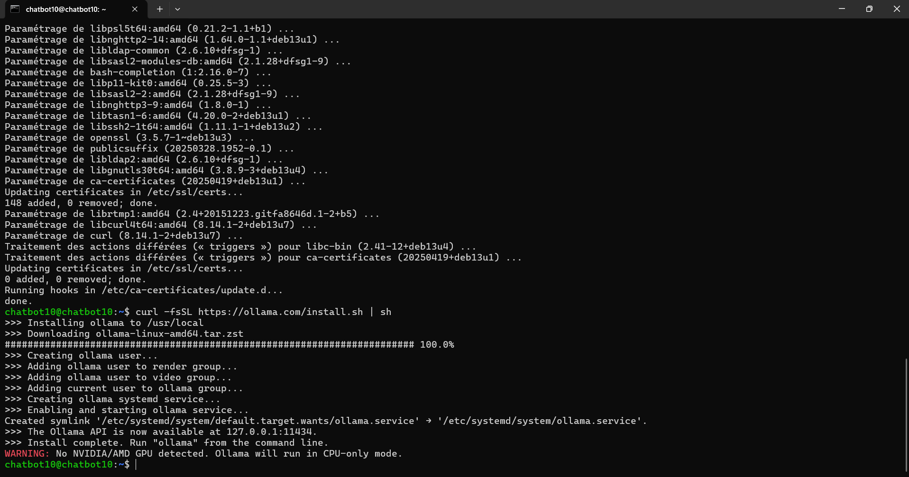{width=90%}
:::

**Vérification du service et de l'API (sur vm-chatbot) :** une installation sans erreur ne prouve pas que le service fonctionne. On vérifie donc qu'il est démarré, qu'il est activé au démarrage, et que l'API répond.

```bash
# État du service (--no-pager : affichage direct, sans pagination)
systemctl status ollama --no-pager
# → Loaded: loaded (/etc/systemd/system/ollama.service; enabled; preset: enabled)
# → Active: active (running) since Sat 2026-11-14 16:10:53 CET; 2min 26s ago
# → Main PID: 3893 (ollama)
# → CGroup: /system.slice/ollama.service
# →         └─3893 /usr/local/bin/ollama serve

# L'API répond-elle sur le port 11434 ?
curl http://localhost:11434
# → Ollama is running
```

::: {.callout-tip}
**📷 Capture :** service Ollama actif et réponse de l'API.

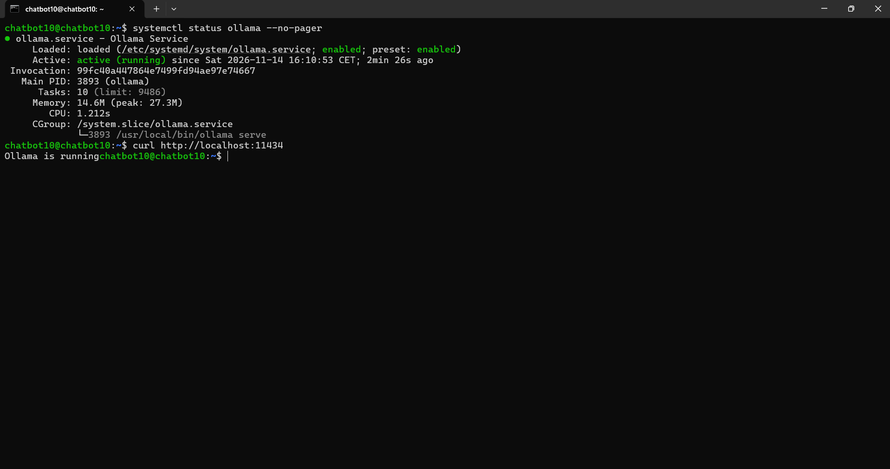{width=90%}
:::

### Téléchargement du modèle (sur vm-chatbot)

**Pourquoi :** Ollama n'est qu'un moteur, il lui faut un modèle de langage à faire tourner. Sans carte graphique, on choisit `llama3.2:1b` (1 milliard de paramètres, 1,3 Go), un des plus petits modèles disponibles, pour garder des temps de réponse acceptables sur le processeur. Une fois téléchargé, le modèle est stocké sur le disque de la VM et fonctionne sans Internet.

```bash
# Télécharger le modèle
ollama pull llama3.2:1b

# Lister les modèles installés
ollama list
```

**Vérification (sur vm-chatbot) :** le téléchargement se termine par `success` et le modèle apparaît dans la liste des modèles installés.

```text
# Sortie de ollama pull
pulling manifest
pulling 74701a8c35f6: 100% ... 1.3 GB
pulling 966de95ca8a6: 100% ... 1.4 KB
pulling 4f659a1e86d7: 100% ...  485 B
verifying sha256 digest
writing manifest
success

# Sortie de ollama list
NAME           ID              SIZE      MODIFIED
llama3.2:1b    baf6a787fdff    1.3 GB    7 seconds ago
```

::: {.callout-tip}
**📷 Capture :** téléchargement du modèle et liste des modèles installés.

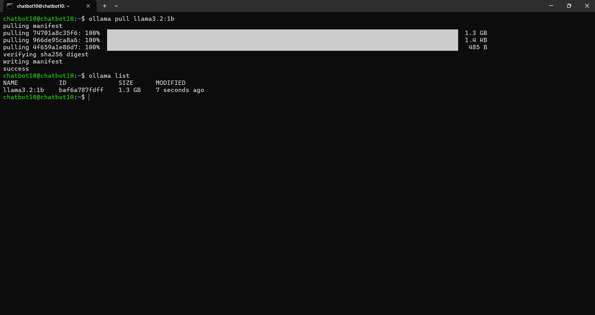{width=90%}
:::

### Test du modèle (sur vm-chatbot) {#sec-test-modele}

**Pourquoi :** avant d'ajouter l'interface web, on vérifie que le modèle répond, d'abord en ligne de commande, puis via l'API HTTP, qui est exactement le canal qu'Open WebUI utilisera pour lui parler.

```bash
# Test direct en ligne de commande
ollama run llama3.2:1b "Bonjour, présente-toi en une phrase."

# Test via l'API, avec mesure du temps de réponse
time curl http://localhost:11434/api/generate -d '{"model":"llama3.2:1b","prompt":"Bonjour","stream":false}'
```

Le corps de la requête (`-d`) est au format JSON. `model` désigne le modèle à utiliser, `prompt` la question, et `"stream":false` demande la réponse en un seul bloc plutôt que mot par mot.

**Vérification (sur vm-chatbot) :**

```text
# Sortie de ollama run
Bonjour, je suis une intelligence artificielle capable de fournir des informations et des divertissements en anglais.

# Sortie de time curl ... /api/generate
{"model":"llama3.2:1b","created_at":"2026-11-14T15:20:31.638652972Z",
 "response":"Bonjour ! Comment puis-je vous aider aujourd'hui ?","done":true,
 "done_reason":"stop", ... "total_duration":809422046, ... "eval_count":12,
 "eval_duration":644115000}
real    0m0,828s
```

L'API renvoie un objet JSON, et la réponse du modèle se trouve dans le champ `response`. La requête complète a pris **0,828 s**, dont 0,64 s de génération pour 12 tokens, soit environ 19 tokens par seconde. C'est rapide parce que la question est très simple et que le modèle était déjà chargé en mémoire par le test précédent.

::: {.callout-note}
Les durées renvoyées par l'API (`total_duration`, `eval_duration`…) sont en **nanosecondes**. Par exemple, `809422046` ns correspondent à 0,81 s.
:::

::: {.callout-tip}
**📷 Capture :** réponse du modèle en ligne de commande et via l'API.

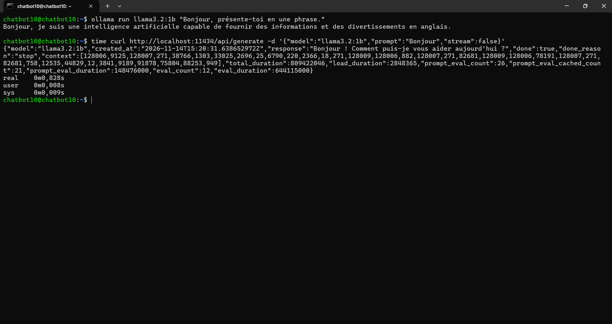{width=90%}
:::

::: {.callout-tip}
**Snapshot conseillé :** Ollama et le modèle fonctionnent, prendre le snapshot `02-ollama-ok` avant de passer à Docker.
:::

### Installation de Docker (sur vm-chatbot)

**Pourquoi :** Open WebUI dépend de Python et de beaucoup de bibliothèques. Docker permet de le lancer dans un conteneur isolé et déjà configuré, sans rien installer à la main. On utilise le dépôt officiel de Docker plutôt que le paquet `docker.io` de Debian, qui est plus ancien.

```bash
# Outils nécessaires au téléchargement en HTTPS
sudo apt install -y ca-certificates curl

# Clé de signature officielle de Docker : permet à apt de vérifier l'authenticité des paquets
sudo install -m 0755 -d /etc/apt/keyrings
sudo curl -fsSL https://download.docker.com/linux/debian/gpg -o /etc/apt/keyrings/docker.asc
sudo chmod a+r /etc/apt/keyrings/docker.asc

# Ajout du dépôt officiel Docker pour Debian 13 (trixie), architecture amd64
D="deb [arch=amd64 signed-by=/etc/apt/keyrings/docker.asc]"
U="https://download.docker.com/linux/debian trixie stable"
echo "$D $U" | sudo tee /etc/apt/sources.list.d/docker.list

# Installation de Docker
sudo apt update
sudo apt install -y docker-ce docker-ce-cli containerd.io

# Autoriser chatbot10 à utiliser Docker sans sudo, puis fermer la session
sudo usermod -aG docker chatbot10
exit
```

Le dépôt doit tenir sur **une seule ligne** dans le fichier `docker.list`. On l'assemble donc à partir de deux variables courtes, `D` et `U`, pour éviter qu'un copier-coller ne coupe la ligne (voir le problème 2 de la section « Problèmes rencontrés »). Les valeurs `amd64` et `trixie` s'obtiennent avec `dpkg --print-architecture` et `. /etc/os-release && echo $VERSION_CODENAME`.

::: {.callout-note}
**Sur Mac**, la VM est en ARM, donc `dpkg --print-architecture` renvoie `arm64`. La première variable devient :

```bash
D="deb [arch=arm64 signed-by=/etc/apt/keyrings/docker.asc]"
```

Le reste ne change pas. Ollama, lui, détecte l'architecture tout seul à l'installation.
:::

L'appartenance au groupe `docker` ne s'applique qu'à la connexion suivante, il faut donc se reconnecter en SSH avant de vérifier.

::: {.callout-warning}
**Sécurité :** un membre du groupe `docker` peut lancer des conteneurs avec des privilèges équivalents à ceux de root. Ce groupe est à réserver aux administrateurs de la VM.
:::

**Vérification (sur vm-chatbot, après reconnexion) :** sans `sudo`, Docker télécharge une image de test, crée un conteneur et l'exécute.

```bash
docker --version
# → Docker version 29.9.3, build 5457199

docker run hello-world
# → Unable to find image 'hello-world:latest' locally
# → latest: Pulling from library/hello-world
# → ...
# → Status: Downloaded newer image for hello-world:latest
# →
# → Hello from Docker!
# → This message shows that your installation appears to be working correctly.
```

::: {.callout-tip}
**📷 Capture :** version de Docker et conteneur de test.

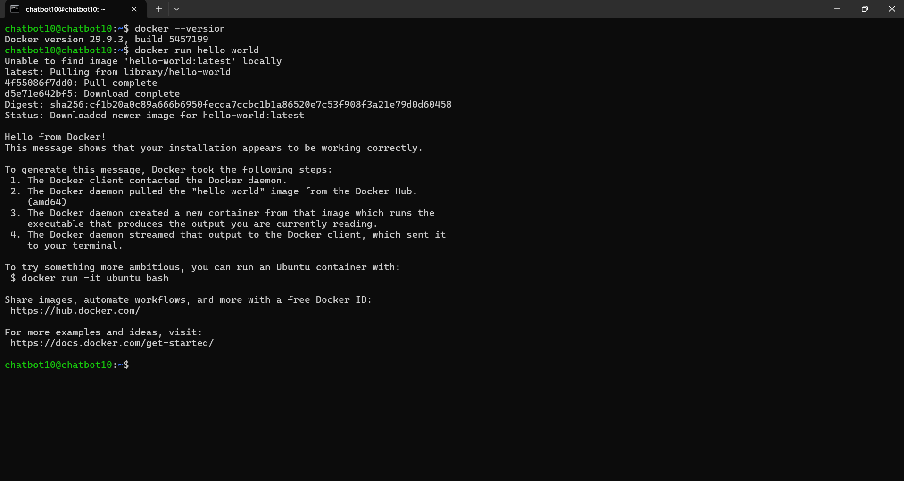{width=90%}
:::

### Ouverture d'Ollama aux conteneurs (sur vm-chatbot)

**Pourquoi :** par défaut, Ollama n'écoute que sur `127.0.0.1`. Or, dans un conteneur Docker, `127.0.0.1` désigne le conteneur lui-même et pas la VM, donc Open WebUI ne pourrait pas joindre Ollama. On fait donc écouter Ollama sur toutes les interfaces de la VM (`0.0.0.0`).

```bash
# Fichier de surcharge du service : le fichier d'origine n'est pas modifié
F=/etc/systemd/system/ollama.service.d/override.conf
sudo mkdir -p /etc/systemd/system/ollama.service.d
printf '[Service]\nEnvironment="OLLAMA_HOST=0.0.0.0"\n' | sudo tee $F

# Relire la configuration de systemd, puis redémarrer Ollama
sudo systemctl daemon-reload
sudo systemctl restart ollama
```

**Vérification (sur vm-chatbot) :** le fichier de surcharge contient le réglage, et Ollama écoute maintenant sur toutes les interfaces (`*`) au lieu de `127.0.0.1` seulement.

```bash
ollama --version
# → ollama version is 0.40.16

cat /etc/systemd/system/ollama.service.d/override.conf
# → [Service]
# → Environment="OLLAMA_HOST=0.0.0.0"

ss -tlnp | grep 11434
# → LISTEN 0      4096       *:11434       *:*
```

::: {.callout-warning}
**Conséquence :** à ce stade, le port 11434 est aussi joignable depuis la machine hôte, sans authentification. C'est temporaire, le pare-feu nftables le limitera ensuite aux seuls conteneurs Docker.
:::

::: {.callout-tip}
**📷 Capture :** version d'Ollama, fichier de surcharge et port d'écoute.

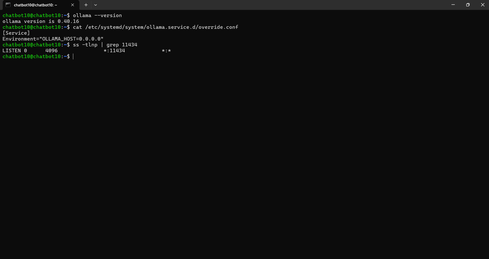{width=90%}
:::

### Lancement d'Open WebUI (sur vm-chatbot)

**Pourquoi :** Open WebUI fournit l'interface web du chatbot (connexion, historique, zone de discussion) et transmet les questions à Ollama. Son port n'est publié que sur `127.0.0.1`, car seul Nginx devra y accéder.

```bash
docker run -d --name open-webui --restart always \
  -p 127.0.0.1:3000:8080 \
  --add-host=host.docker.internal:host-gateway \
  -e OLLAMA_BASE_URL=http://host.docker.internal:11434/ \
  -v open-webui:/app/backend/data \
  ghcr.io/open-webui/open-webui:main
```

| Option | Rôle |
|---|---|
| `-d` | Conteneur lancé en arrière-plan |
| `--name open-webui` | Nom du conteneur, utilisé dans les commandes suivantes |
| `--restart always` | Relance automatique au redémarrage de la VM |
| `-p 127.0.0.1:3000:8080` | Port 8080 du conteneur publié sur le port 3000 de la VM, **en local uniquement** |
| `--add-host=host.docker.internal:host-gateway` | Nom `host.docker.internal` par lequel le conteneur joint la VM |
| `-e OLLAMA_BASE_URL=http://host.docker.internal:11434/` | Adresse à laquelle Open WebUI trouve Ollama |
| `-v open-webui:/app/backend/data` | Volume persistant : comptes et conversations conservés si le conteneur est recréé |

::: {.callout-note}
**Deux variables à ne pas confondre.** `OLLAMA_HOST` (étape précédente) est l'adresse sur laquelle **Ollama écoute**, alors que `OLLAMA_BASE_URL` est l'adresse à laquelle **Open WebUI le cherche**. Il faut les deux.
:::

Au premier lancement, Docker télécharge l'image (plusieurs Go, répartis en couches), puis affiche l'identifiant du conteneur créé.

```text
main: Pulling from open-webui/open-webui
4f4fb700ef54: Pull complete
...
60cb5f44e697: Pull complete
...
Digest: sha256:59b912d4246103c7285de0e9a5f2f6586614c06b4c4e46edc51a8f29e7b099a5
Status: Downloaded newer image for ghcr.io/open-webui/open-webui:main
4a727b43f53da30860eee0e909f2dd957f08a1651e73fae3105c3f484514f897
```

L'étiquette `:main` désigne la version la plus récente au moment du téléchargement, et l'empreinte (`Digest`) identifie précisément l'image utilisée pour ce projet. Dans notre cas, il s'agit d'Open WebUI **v0.13.3** (numéro affiché dans l'interface).

::: {.callout-tip}
**📷 Capture :** téléchargement de l'image et création du conteneur.

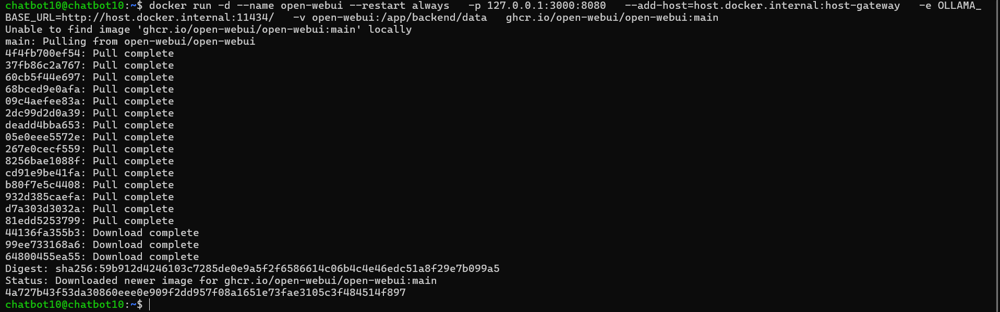{width=90%}
:::

Notre premier lancement a été interrompu en plein téléchargement (voir le problème 3 de la section « Problèmes rencontrés »).

**Vérification (sur vm-chatbot) :** après environ deux minutes de démarrage, le conteneur est en bonne santé (`healthy`), son port n'est publié qu'en local, et l'interface web répond.

```bash
docker ps
# → CONTAINER ID   IMAGE                                COMMAND           CREATED         STATUS                   PORTS                      NAMES
# → 4a727b43f53d   ghcr.io/open-webui/open-webui:main   "bash start.sh"   2 minutes ago   Up 2 minutes (healthy)   127.0.0.1:3000->8080/tcp   open-webui

curl -I http://127.0.0.1:3000/
# → HTTP/1.1 200 OK
# → server: uvicorn
# → content-type: text/html; charset=utf-8
# → content-length: 14135

# Adresse d'Ollama enregistrée dans le conteneur
docker exec open-webui printenv OLLAMA_BASE_URL
# → http://host.docker.internal:11434/

# Espace occupé sur le disque de la VM
df -h /
# → Sys. de fichiers Taille Utilisé Dispo Uti% Monté sur
# → /dev/sda1           38G     13G   23G  35% /
```

::: {.callout-tip}
**📷 Capture :** conteneur `healthy`, réponse HTTP et espace disque de la VM.

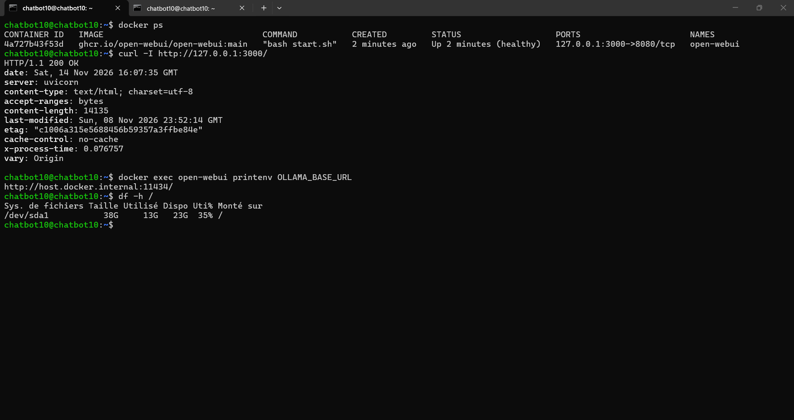{width=90%}
:::

**Vérification de l'adresse utilisée par le conteneur (sur vm-chatbot) :** le nom `host.docker.internal` correspond bien à l'adresse de la VM sur l'interface `docker0`.

```bash
ip -br addr show docker0
# → docker0          UP             172.17.0.1/16 fe80::...

docker exec open-webui getent hosts host.docker.internal
# → 172.17.0.1      host.docker.internal
```

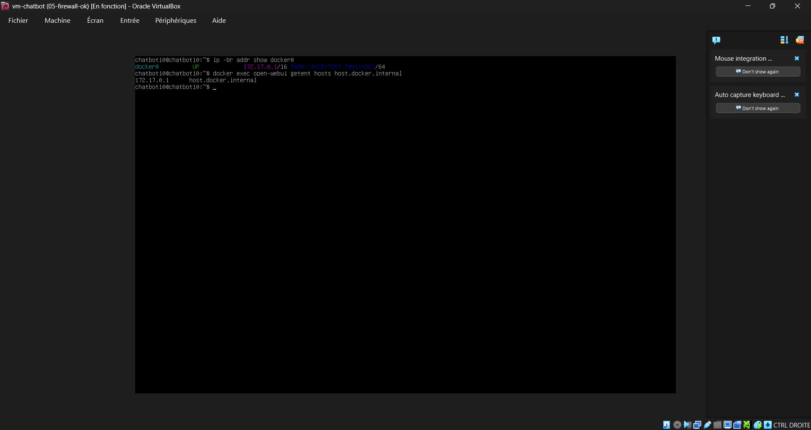{width=90%}

C'est donc par l'adresse `172.17.0.1`, et par l'interface `docker0`, qu'Open WebUI joint Ollama. On s'en sert plus loin dans les règles du pare-feu.

### Premier accès à l'interface (depuis la machine hôte) {#sec-premier-acces}

**Pourquoi :** Open WebUI n'écoute qu'en local sur la VM, donc le navigateur de la machine hôte ne peut pas l'atteindre directement. En attendant Nginx, on y accède par un tunnel SSH, qui relie le port 3000 de la machine hôte au port 3000 de la VM à travers la connexion SSH. Cela permet de tester l'application sans exposer son port sur le réseau.

```powershell
# Sur la machine hôte, dans un nouveau terminal à laisser ouvert
ssh -L 3000:127.0.0.1:3000 chatbot10@192.168.56.10
```

::: {.callout-tip}
**📷 Capture :** tunnel SSH ouvert depuis la machine hôte.

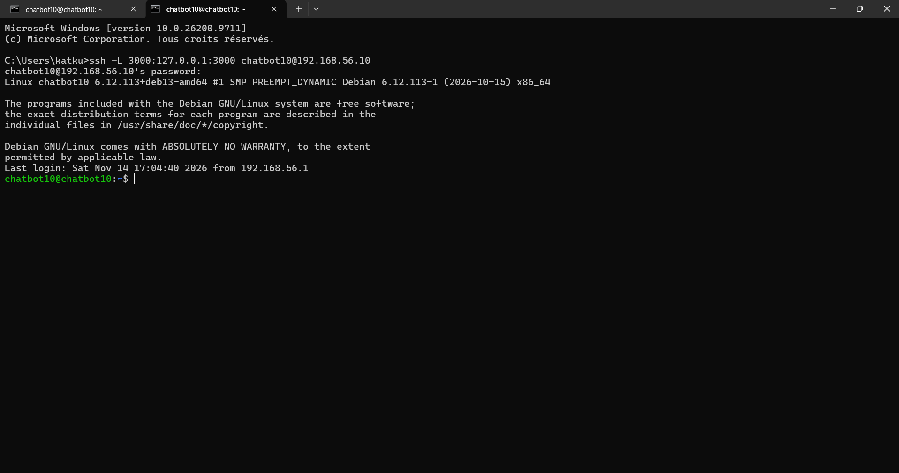{width=90%}
:::

Puis, dans un navigateur de la machine hôte, à l'adresse `http://localhost:3000` :

1. Cliquer sur **Démarrer** et créer le premier compte, qui devient automatiquement **administrateur**. L'adresse e-mail sert uniquement d'identifiant, aucun message n'est envoyé.
2. Vérifier que le modèle `llama3.2:1b` est proposé en haut de la page.
3. Poser une question.

**Vérification (navigateur de la machine hôte) :** le modèle `llama3.2:1b` apparaît dans l'interface, ce qui prouve qu'Open WebUI joint bien Ollama, et la question « Quelle est la capitale de la Belgique ? » reçoit la réponse « La réponse finale est Bruxelles. ».

La chaîne **navigateur → tunnel SSH → Open WebUI (conteneur) → Ollama → modèle** fonctionne. La première réponse est lente (plus d'une minute), parce qu'Ollama doit charger le modèle en mémoire et que tout se fait sur le processeur.

::: {.callout-tip}
**📷 Capture :** première réponse du modèle dans Open WebUI.

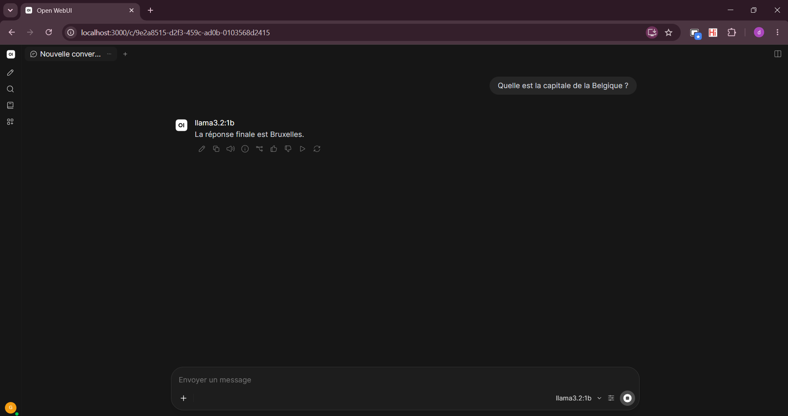{width=90%}
:::

### Contrôle des inscriptions (dans Open WebUI)

**Pourquoi :** Open WebUI a son propre système de comptes. Si les inscriptions étaient libres, n'importe qui arrivant sur la page pourrait se créer un compte et utiliser le chatbot. Seul l'administrateur doit pouvoir donner accès au service.

Dans Open WebUI, connecté avec le compte administrateur, on va dans **Panneau d'administration → Réglages → Authentification**.

**Vérification (navigateur de la machine hôte) :** dans la version installée (v0.13.3), les réglages sont déjà restrictifs par défaut, donc nous n'avons rien eu à modifier.

| Réglage | Valeur constatée | Effet |
|---|---|---|
| Rôle utilisateur par défaut | `en attente` | Un compte éventuellement créé reste bloqué jusqu'à validation par l'administrateur |
| Nouveaux comptes | désactivé | Le formulaire d'inscription n'est pas proposé |
| Formulaire de connexion | activé | La connexion par e-mail et mot de passe reste possible |

::: {.callout-tip}
**📷 Capture :** réglages d'authentification d'Open WebUI.

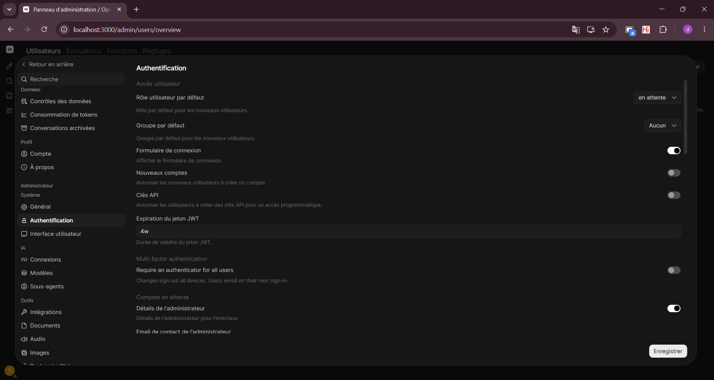{width=90%}
:::

::: {.callout-tip}
**Snapshot conseillé :** Open WebUI communique avec Ollama, prendre le snapshot `03-openwebui-ok` avant de passer à Nginx.
:::

### Installation de Nginx (sur vm-chatbot)

**Pourquoi :** Nginx sert de reverse proxy, c'est-à-dire de porte d'entrée unique. Il reçoit les connexions HTTPS des utilisateurs et les transmet à Open WebUI, qui reste caché derrière lui en local. On n'a plus besoin du tunnel SSH.

```bash
sudo apt update
sudo apt install -y nginx
```

**Vérification (sur vm-chatbot) :** le service est actif, activé au démarrage, et sert sa page par défaut.

```bash
systemctl status nginx --no-pager
# → Loaded: loaded (/usr/lib/systemd/system/nginx.service; enabled; preset: enabled)
# → Active: active (running) since Tue 2026-11-17 12:49:33 CET; 2min 14s ago
# → CGroup: /system.slice/nginx.service
# →         ├─1702 "nginx: master process /usr/sbin/nginx -g daemon on; master_process on;"
# →         ├─1705 "nginx: worker process"
# →         ...

curl -I http://localhost/
# → HTTP/1.1 200 OK
# → Server: nginx
# → Content-Type: text/html
# → Content-Length: 615
```

La version installée est Nginx **1.26.3** (paquet `1.26.3-3+deb13u10` de Debian). Un processus principal (*master*) pilote quatre processus *worker*, un par cœur de la VM, qui traitent les requêtes.

::: {.callout-tip}
**📷 Capture :** service Nginx actif et réponse de sa page par défaut.

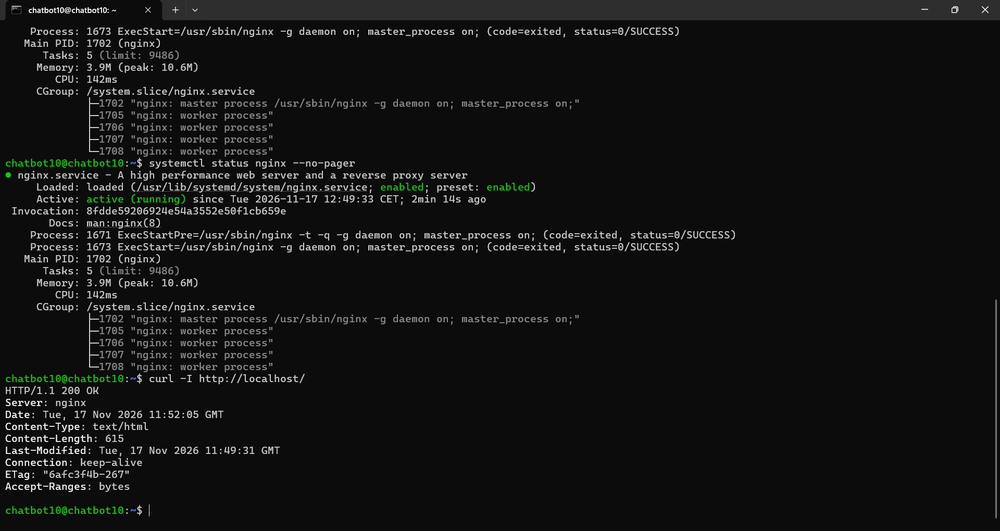{width=90%}
:::

### Génération du certificat TLS (sur vm-chatbot)

**Pourquoi :** le HTTPS chiffre les échanges entre le navigateur et Nginx, y compris les mots de passe et les conversations, et il faut pour cela un certificat. Un certificat délivré par une autorité reconnue (comme Let's Encrypt) demande un nom de domaine public. En laboratoire, un certificat **auto-signé** suffit pour montrer que le chiffrement fonctionne.

```bash
# Dossier dédié aux fichiers du certificat
sudo mkdir -p /etc/ssl/chatbot

# Clé privée (.key) + certificat auto-signé (.crt), valables 365 jours,
# émis pour le nom chatbot.local et l'IP 192.168.56.10
sudo openssl req -x509 -nodes -days 365 -newkey rsa:2048 \
  -keyout /etc/ssl/chatbot/chatbot.key \
  -out /etc/ssl/chatbot/chatbot.crt \
  -subj "/C=BE/ST=Bruxelles/L=Bruxelles/O=Groupe10/CN=chatbot.local" \
  -addext "subjectAltName=DNS:chatbot.local,IP:192.168.56.10"
```

| Option | Rôle |
|---|---|
| `req -x509` | Produit directement un certificat auto-signé |
| `-nodes` | Clé privée non chiffrée par mot de passe, sinon Nginx le demanderait à chaque démarrage |
| `-days 365` | Durée de validité |
| `-newkey rsa:2048` | Génère une nouvelle clé RSA de 2048 bits |
| `-keyout` / `-out` | Emplacements de la clé privée (secrète) et du certificat (public) |
| `-subj` | Identité du certificat, dont le nom `CN=chatbot.local` |
| `-addext "subjectAltName=..."` | Noms et adresses acceptés ; c'est ce champ que vérifient les navigateurs récents |

**Vérification (sur vm-chatbot) :** les deux fichiers existent, la clé privée n'est lisible que par root, et le certificat est émis pour `chatbot.local` pour un an.

```bash
sudo ls -l /etc/ssl/chatbot/
# → -rw-r--r-- 1 root root 1363 17 nov 12:54 chatbot.crt
# → -rw------- 1 root root 1704 17 nov 12:54 chatbot.key

sudo openssl x509 -in /etc/ssl/chatbot/chatbot.crt -noout -subject -dates
# → subject=C=BE, ST=Bruxelles, L=Bruxelles, O=Groupe10, CN=chatbot.local
# → notBefore=Nov 17 11:54:00 2026 GMT
# → notAfter=Nov 17 11:54:00 2027 GMT
```

::: {.callout-tip}
**📷 Capture :** création du certificat, fichiers et dates de validité.

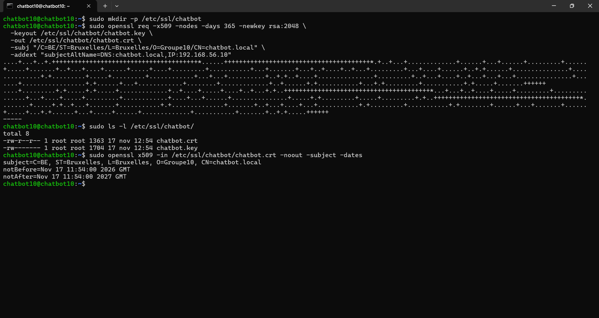{width=90%}
:::

### Configuration de Nginx en reverse proxy HTTPS (sur vm-chatbot)

**Pourquoi :** c'est le cœur de la phase. Nginx redirige le HTTP vers le HTTPS, chiffre la connexion avec le certificat, puis transmet les requêtes à Open WebUI, qui n'est joignable qu'en local (`127.0.0.1:3000`).

```bash
sudo tee /etc/nginx/sites-available/chatbot > /dev/null << 'EOF'
# HTTP : redirige tout vers HTTPS
server {
    listen 80;
    server_name chatbot.local 192.168.56.10;
    return 301 https://$host$request_uri;
}

# HTTPS : point d'entrée, transmet à Open WebUI
server {
    listen 443 ssl;
    server_name chatbot.local 192.168.56.10;

    ssl_certificate     /etc/ssl/chatbot/chatbot.crt;
    ssl_certificate_key /etc/ssl/chatbot/chatbot.key;
    ssl_protocols       TLSv1.2 TLSv1.3;

    location / {
        proxy_pass http://127.0.0.1:3000;

        # WebSocket (sinon le chat reste bloqué)
        proxy_http_version 1.1;
        proxy_set_header Upgrade $http_upgrade;
        proxy_set_header Connection "upgrade";

        # Infos sur le vrai client
        proxy_set_header Host $host;
        proxy_set_header X-Real-IP $remote_addr;
        proxy_set_header X-Forwarded-For $proxy_add_x_forwarded_for;
        proxy_set_header X-Forwarded-Proto $scheme;

        # Le modèle est lent : on attend jusqu'à 5 min
        proxy_read_timeout 300s;
        proxy_buffering off;
    }
}
EOF
```

| Directive | Rôle |
|---|---|
| `return 301 https://$host$request_uri` | Redirection permanente de tout le trafic HTTP vers HTTPS |
| `listen 443 ssl` + `ssl_certificate*` | Terminaison TLS avec le certificat auto-signé |
| `ssl_protocols TLSv1.2 TLSv1.3` | Refuse les versions obsolètes de TLS, qui ont des failles connues |
| `proxy_pass http://127.0.0.1:3000` | Transmet les requêtes à Open WebUI |
| `Upgrade` / `Connection "upgrade"` | Laisse passer les WebSockets, qu'Open WebUI utilise pour sa connexion en temps réel avec le navigateur (adresse `/ws/socket.io`, visible dans le journal de Nginx au test de panne) |
| `X-Forwarded-For` / `X-Forwarded-Proto` | Transmet à Open WebUI l'adresse réelle du client et le protocole d'origine (HTTPS) |
| `proxy_read_timeout 300s` | Temps maximum d'attente **entre deux envois de données** d'Open WebUI (60 s par défaut). Le compteur repart à chaque morceau reçu, donc ce réglage compte surtout pendant l'attente du premier mot, quand le modèle se charge |
| `proxy_buffering off` | Transmet les réponses HTTP en flux, morceau par morceau, sans attendre la fin. C'est un mécanisme différent des WebSockets |

Activation du site et désactivation de la page par défaut :

```bash
# Nginx ne lit que les sites présents dans sites-enabled : on y crée un lien vers notre fichier
sudo ln -s /etc/nginx/sites-available/chatbot /etc/nginx/sites-enabled/chatbot
sudo rm /etc/nginx/sites-enabled/default

# Vérifier la syntaxe avant d'appliquer
sudo nginx -t

# Appliquer la configuration sans couper le service
sudo systemctl reload nginx
```

**Vérification (sur vm-chatbot) :**

```bash
sudo nginx -t
# → nginx: the configuration file /etc/nginx/nginx.conf syntax is ok
# → nginx: configuration file /etc/nginx/nginx.conf test is successful
```

::: {.callout-tip}
**📷 Capture :** fichier de configuration, activation du site et test de syntaxe.

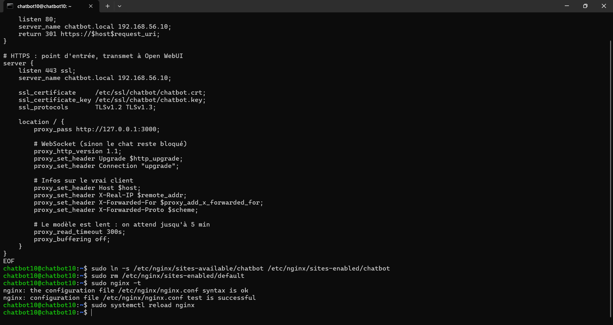{width=90%}
:::

### Résolution du nom chatbot.local (sur la machine hôte) {#sec-chatbot-local}

**Pourquoi :** le certificat est émis pour `chatbot.local`. Pour accéder au chatbot par ce nom plutôt que par l'adresse IP, la machine hôte doit savoir qu'il correspond à `192.168.56.10`. Aucun serveur DNS ne connaît ce nom local, donc on l'indique dans le fichier `hosts` de la machine hôte, que le système consulte avant le DNS.

Sur la **machine hôte Windows** :

1. Ouvrir le Bloc-notes **en tant qu'administrateur** (le fichier est protégé).
2. Ouvrir `C:\Windows\System32\drivers\etc\hosts`, en choisissant le type « Tous les fichiers (\*.\*) », car le fichier n'a pas d'extension.
3. Ajouter à la fin la ligne suivante, puis enregistrer :

```text
192.168.56.10  chatbot.local
```

Dans notre cas, la ligne était déjà présente depuis un essai précédent, il ne fallait donc pas la rajouter une deuxième fois.

::: {.callout-note}
**Sur macOS ou Linux**, le fichier est `/etc/hosts`, et la ligne s'ajoute depuis un terminal :

```bash
echo "192.168.56.10 chatbot.local" | sudo tee -a /etc/hosts
```

Dans le Terminal du Mac, on écrit simplement `curl` au lieu de `curl.exe`, par exemple `curl -kI https://chatbot.local/`.

Sur macOS, si Chrome refuse d'ouvrir `https://chatbot.local` (`ERR_ADDRESS_UNREACHABLE`) alors que `curl` fonctionne, il faut autoriser le navigateur dans **Réglages Système → Confidentialité et sécurité → Réseau local**.
:::

**Vérification (machine hôte, PowerShell) :** le nom est traduit en adresse de la VM, et Nginx répond en HTTPS avec la page d'Open WebUI.

```powershell
ping chatbot.local
# → Envoi d'une requête 'ping' sur chatbot.local [192.168.56.10] avec 32 octets de données :
# → Réponse de 192.168.56.10 : octets=32 temps=1 ms TTL=64
# → Paquets : envoyés = 4, reçus = 4, perdus = 0 (perte 0%)

# -k : accepte le certificat auto-signé ; -I : en-têtes seulement
# (dans PowerShell, « curl » seul désigne une autre commande : il faut écrire curl.exe)
curl.exe -kI https://chatbot.local/
# → HTTP/1.1 200 OK
# → Server: nginx
# → Content-Type: text/html; charset=utf-8
# → Content-Length: 14135
```

L'en-tête `Server: nginx` montre que c'est bien Nginx qui répond. Et `Content-Length: 14135` correspond à la taille de la page d'Open WebUI obtenue en local à la phase 3, donc Nginx transmet bien la page d'Open WebUI.

::: {.callout-tip}
**📷 Capture :** résolution de `chatbot.local` et réponse HTTPS depuis la machine hôte.

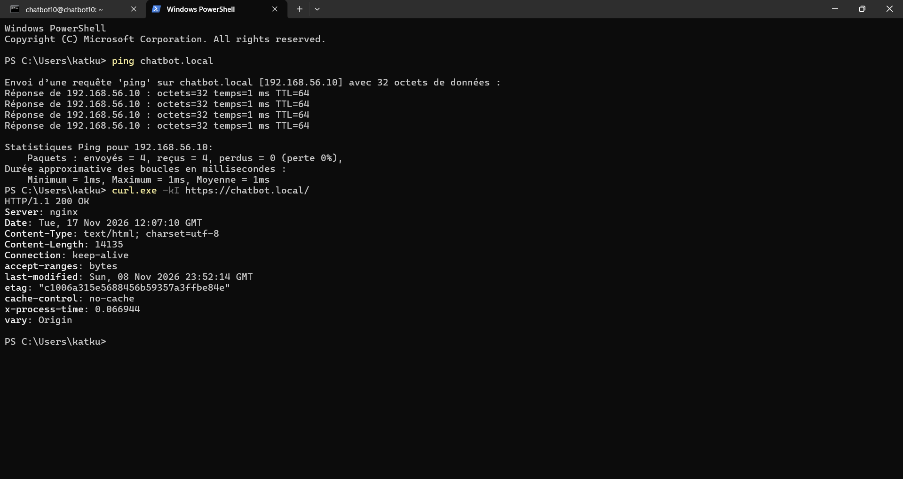{width=90%}
:::

**Vérification de la redirection HTTP → HTTPS (machine hôte, PowerShell) :** une requête en HTTP non chiffré est renvoyée vers la version HTTPS.

```powershell
curl.exe -I http://chatbot.local/
# → HTTP/1.1 301 Moved Permanently
# → Server: nginx
# → Content-Length: 162
# → Location: https://chatbot.local/
```

Le code `301` signifie « déplacé définitivement ». Le navigateur suit automatiquement l'adresse indiquée dans `Location`, et aucune page du chatbot n'est servie en clair.

::: {.callout-tip}
**📷 Capture :** redirection `301` vers `https://chatbot.local/`.

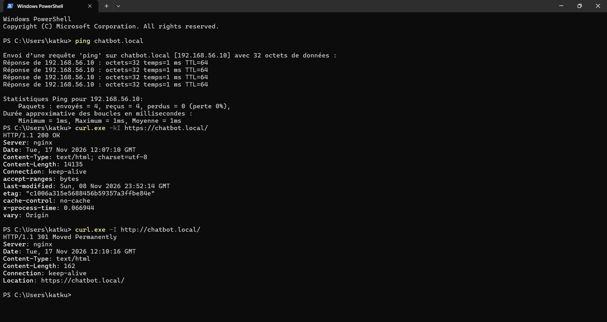{width=90%}
:::

**Vérification dans le navigateur (machine hôte) :** le tunnel SSH n'est plus nécessaire, on ouvre directement `https://chatbot.local`.

1. Le navigateur affiche « Votre connexion n'est pas privée », parce que le certificat est auto-signé et n'est donc signé par aucune autorité reconnue. C'est normal dans notre contexte, et le trafic est quand même chiffré. On passe l'avertissement avec **Paramètres avancés → Continuer vers chatbot.local (non sécurisé)**.

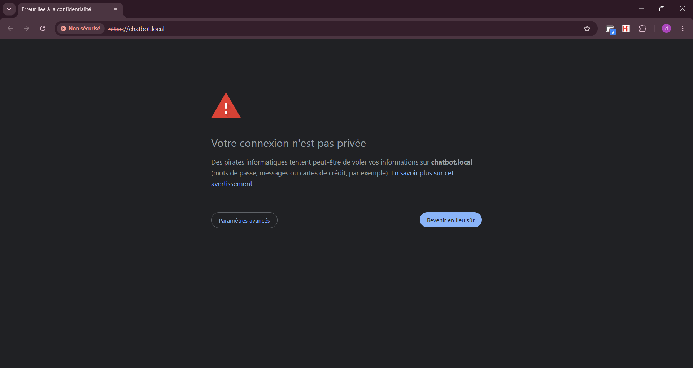{width=90%}

2. Après connexion avec le compte administrateur, la question « Explique en une phrase à quoi sert HTTPS. » reçoit la réponse « HTTPS (Hypertext Transfer Protocol Secure) est un protocole de communication en internet qui sécurise la transmission de données entre un client et un serveur. » La chaîne complète **navigateur → Nginx (HTTPS) → Open WebUI → Ollama** fonctionne.

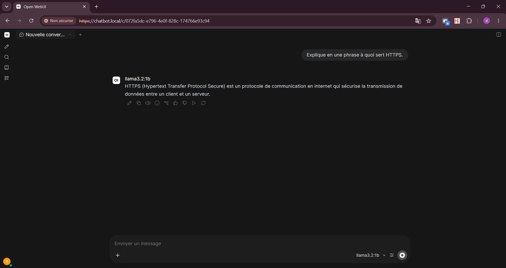{width=90%}

3. Dans une fenêtre de navigation privée, donc sans session ouverte, `https://chatbot.local` redirige vers la page « Connectez-vous à Open WebUI » (adresse `/auth`). Seuls les champs e-mail et mot de passe sont proposés, sans lien d'inscription.

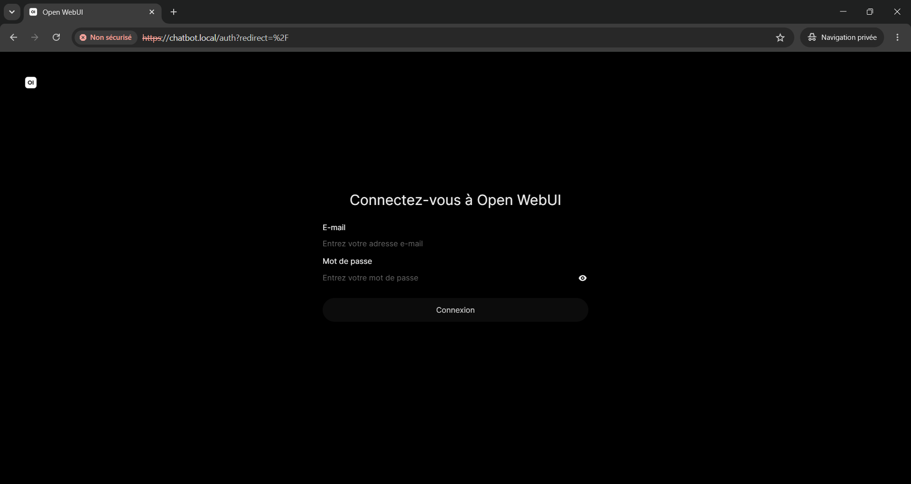{width=90%}

::: {.callout-tip}
**Snapshot conseillé :** Nginx sert le chatbot en HTTPS, prendre le snapshot `04-nginx-https-ok` avant de configurer le pare-feu.
:::

### Configuration du pare-feu nftables (sur vm-chatbot) {#sec-pare-feu}

**Pourquoi :** sans pare-feu, rien ne filtre le trafic entrant, et tout service qui écoute sur une interface réseau de la VM est joignable. C'est le cas d'Ollama depuis la phase 3 : il écoute sur toutes les interfaces et n'a aucune authentification, donc n'importe quelle machine du réseau peut utiliser le modèle sans passer par la connexion d'Open WebUI. On applique ici la règle de sécurité de base du syllabus (section 2.6), qui consiste à bloquer tous les ports sauf ceux des applications utilisées.

**Constat avant le pare-feu (machine hôte, PowerShell) :**

```powershell
curl.exe --max-time 5 http://192.168.56.10:11434/
# → Ollama is running

curl.exe --max-time 5 http://192.168.56.10:3000/
# → curl: (7) Failed to connect to 192.168.56.10:3000 after 2010 ms: Could not connect to server
```

Ollama répond directement à la machine hôte. Open WebUI, lui, est déjà inaccessible, car Docker ne publie son port que sur `127.0.0.1`, et la connexion est refusée tout de suite.

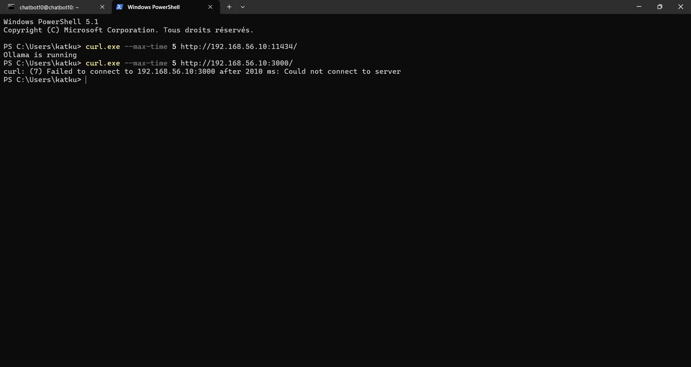{width=90%}

**Politique retenue :** tout trafic entrant est refusé par défaut, sauf les exceptions suivantes.

| Trafic autorisé | Depuis | Raison |
|---|---|---|
| Boucle locale (`lo`) | la VM elle-même | Nginx → Open WebUI sur `127.0.0.1:3000` |
| Connexions établies ou associées | partout | Réponses aux connexions ouvertes par la VM (apt, téléchargements) |
| ICMP / ICMPv6 | partout | Ping de diagnostic, fonctionnement de base d'IPv6 |
| UDP 67 → 68 | carte NAT `enp0s3` | Réponses du serveur DHCP de VirtualBox |
| TCP 22, 80, 443 | carte host-only `enp0s8` | SSH, HTTP (redirection), HTTPS |
| TCP 11434 | interface Docker `docker0` | Open WebUI → Ollama |
| Tout le reste | — | Refusé (`policy drop`) |

**Écriture et vérification des règles, sans les appliquer :**

```bash
# Sauvegarde du fichier d'origine
sudo cp /etc/nftables.conf /etc/nftables.conf.bak

sudo tee /etc/nftables.conf > /dev/null << 'EOF'
#!/usr/sbin/nft -f
# Pas de "flush ruleset" : il effacerait les règles créées par Docker.
# On supprime puis recrée uniquement notre table.
table inet filtre
delete table inet filtre

table inet filtre {
    chain input {
        type filter hook input priority 0; policy drop;

        # Boucle locale (Nginx -> Open WebUI sur 127.0.0.1)
        iif "lo" accept

        # Réponses aux connexions déjà établies
        ct state established,related accept
        ct state invalid drop

        # Ping (et IPv6 de base)
        ip protocol icmp accept
        ip6 nexthdr icmpv6 accept

        # DHCP sur la carte NAT
        iifname "enp0s3" udp sport 67 udp dport 68 accept

        # SSH, HTTP et HTTPS uniquement depuis le réseau host-only
        iifname "enp0s8" tcp dport { 22, 80, 443 } accept

        # Ollama uniquement depuis les conteneurs Docker
        iifname "docker0" tcp dport 11434 accept
    }
}
EOF

# Vérifier la syntaxe sans rien appliquer
sudo nft -c -f /etc/nftables.conf && echo "SYNTAXE OK"
# → SYNTAXE OK
```

| Élément | Rôle |
|---|---|
| `table inet filtre` | Table de règles propre au projet, valable pour IPv4 et IPv6 (`inet`) |
| `table inet filtre` puis `delete table inet filtre` | Crée la table si elle n'existe pas, puis la supprime : le fichier peut être rechargé plusieurs fois sans dupliquer les règles |
| `hook input` | La chaîne contrôle le trafic **entrant** dans la VM |
| `policy drop` | Règle par défaut : tout paquet qui ne correspond à aucune exception est jeté |
| `ct state` | Suivi des connexions (*connection tracking*) : distingue une réponse attendue d'une nouvelle connexion |
| `iifname` | Interface par laquelle le paquet est arrivé |

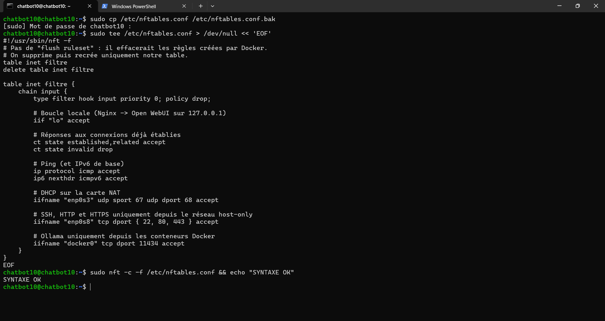{width=90%}

::: {.callout-important}
**Sur Mac**, deux lignes des règles changent, à cause des noms de cartes :

```text
iifname "enp0s8" udp sport 67 udp dport 68 accept
iifname "enp0s9" tcp dport { 22, 80, 443 } accept
```

Attention, si on garde les noms du PC, la règle des ports 22, 80 et 443 s'applique à `enp0s8`, qui sur Mac est la **carte NAT**. Ces ports restent donc fermés sur la carte host-only `enp0s9`, et le SSH comme le site sont bloqués depuis le Mac. La règle DHCP, elle, vise `enp0s3`, qui n'existe pas sur Mac. En cas d'oubli, il faut passer par la console VirtualBox et taper `sudo nft delete table inet filtre`.
:::

**Application des règles :**

```bash
# Appliquer les règles (la session SSH, déjà établie et sur le port 22, n'est pas coupée)
sudo nft -f /etc/nftables.conf

# Recharger les règles à chaque démarrage
sudo systemctl enable nftables
# → Created symlink '/etc/systemd/system/sysinit.target.wants/nftables.service' → '/usr/lib/systemd/system/nftables.service'.
```

::: {.callout-warning}
**Deux pièges liés à Docker :**

- Le fichier par défaut de Debian commence par `flush ruleset`, qui efface **toutes** les règles du système, y compris celles que Docker crée pour ses conteneurs. Nous l'avons remplacé par la suppression de notre seule table.
- Sous Debian, l'arrêt du service `nftables` (donc aussi `systemctl restart nftables`) vide toutes les règles. Pour recharger le fichier, on utilise toujours `sudo nft -f /etc/nftables.conf`.

**En cas de blocage** (plus d'accès SSH), il faut se connecter dans la console VirtualBox de la VM et lancer `sudo nft delete table inet filtre`, ou revenir au snapshot `04-nginx-https-ok`.
:::

**Vérification (sur vm-chatbot) :** notre table est chargée, et les tables créées par Docker sont toujours présentes.

```bash
sudo nft list tables
# → table ip nat
# → table ip filter
# → table ip6 nat
# → table ip6 filter
# → table ip raw
# → table inet filtre

sudo nft list table inet filtre
# → table inet filtre {
# →         chain input {
# →                 type filter hook input priority filter; policy drop;
# →                 iif "lo" accept
# →                 ct state established,related accept
# →                 ct state invalid drop
# →                 ip protocol icmp accept
# →                 ip6 nexthdr ipv6-icmp accept
# →                 iifname "enp0s3" udp sport 67 udp dport 68 accept
# →                 iifname "enp0s8" tcp dport { 22, 80, 443 } accept
# →                 iifname "docker0" tcp dport 11434 accept
# →         }
# → }
```

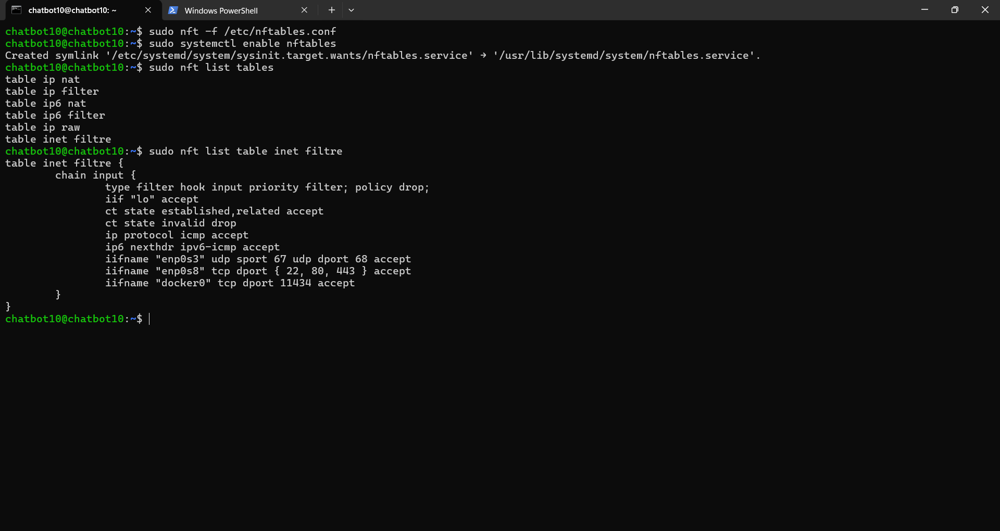{width=90%}

**Vérification (machine hôte, PowerShell) :** les ports internes ne sont plus joignables, le site l'est toujours.

```powershell
curl.exe --max-time 5 http://192.168.56.10:11434/
# → curl: (28) Connection timed out after 5000 milliseconds

curl.exe --max-time 5 http://192.168.56.10:3000/
# → curl: (28) Connection timed out after 5000 milliseconds

curl.exe -kI https://chatbot.local/
# → HTTP/1.1 200 OK
# → Server: nginx
```

| Port | Avant le pare-feu | Après le pare-feu |
|---|---|---|
| 11434 (Ollama) | `Ollama is running` | Délai dépassé : **bloqué** |
| 3000 (Open WebUI) | Connexion refusée | Délai dépassé |
| 443 (Nginx, HTTPS) | `200 OK` | `200 OK` |

Le message change pour le port 3000. Avant, la VM **refusait** la connexion tout de suite, parce que rien n'écoutait sur cette adresse. Maintenant, le pare-feu **jette** le paquet sans répondre, et le client attend jusqu'au délai de 5 secondes. Ce port est donc protégé deux fois, par la publication Docker limitée à `127.0.0.1` et par le pare-feu. Comme il était déjà fermé avant, ce n'est pas lui qui prouve l'effet du pare-feu, mais le port 11434, ouvert avant et bloqué après.

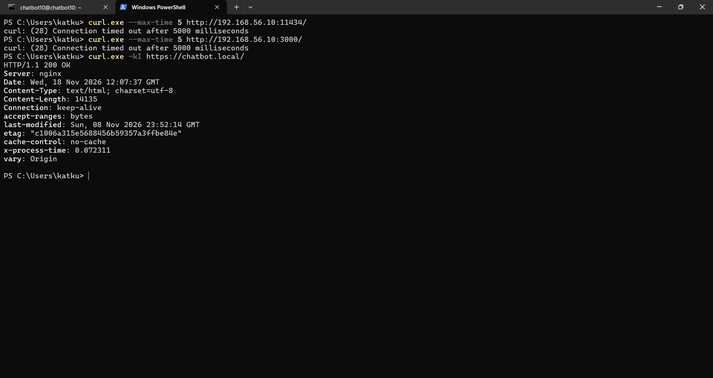{width=90%}

**Vérification (sur vm-chatbot) :** le conteneur Open WebUI joint toujours Ollama, par l'interface `docker0` autorisée.

```bash
docker exec open-webui curl -s http://host.docker.internal:11434
# → Ollama is running
```

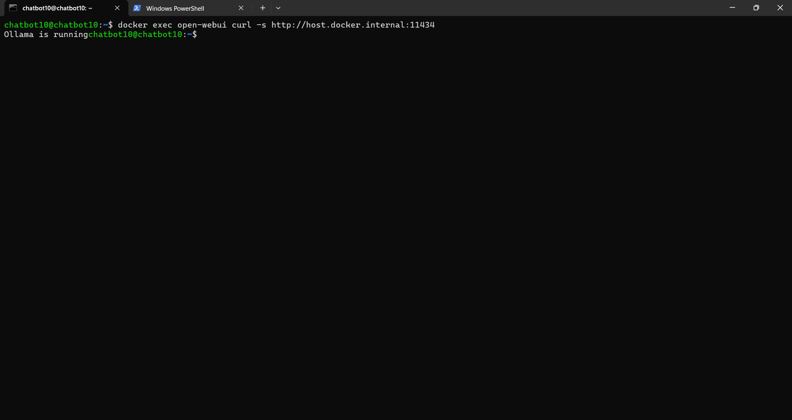{width=90%}

**Vérification (depuis le navigateur de l'hôte) :** sur `https://chatbot.local`, la question « Explique en une phrase à quoi sert un pare-feu. » obtient une réponse de `llama3.2:1b`. Le chemin complet navigateur → Nginx → Open WebUI → Ollama fonctionne donc avec le pare-feu actif.

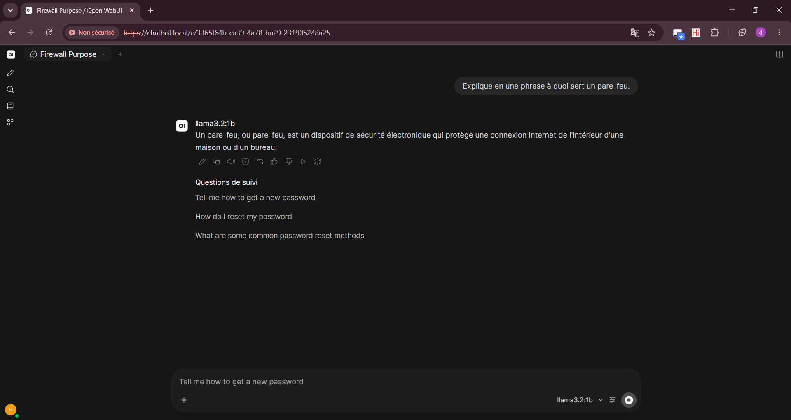{width=90%}

La réponse elle-même est approximative (le modèle parle de « connexion Internet d'une maison »). Cela vient du petit modèle de 1 milliard de paramètres, pas de l'infrastructure, puisque la question est bien transmise et que la réponse revient.

### Redémarrage : tout revient seul (sur vm-chatbot) {#sec-reboot}

**Pourquoi :** un serveur doit survivre à un redémarrage (coupure de courant, mise à jour) sans qu'on doive tout relancer à la main. C'est surtout un test pour le pare-feu, car `sudo nft -f` applique les règles immédiatement, mais seul `systemctl enable nftables` les recharge au démarrage.

```bash
sudo reboot
```

La session SSH se coupe. Après environ une minute, on se reconnecte depuis l'hôte (`ssh chatbot10@192.168.56.10`). Le simple fait que la connexion fonctionne montre déjà que le pare-feu rechargé laisse passer le port 22.

**Vérification (sur vm-chatbot) :**

```bash
systemctl is-active ollama docker nginx nftables
# → active
# → active
# → active
# → active

sudo nft list tables
# → table inet filtre
# → table ip nat
# → table ip filter
# → table ip6 nat
# → table ip6 filter
# → table ip raw

docker ps
# → ... ghcr.io/open-webui/open-webui:main ... Up 42 seconds (health: starting)   127.0.0.1:3000->8080/tcp   open-webui
```

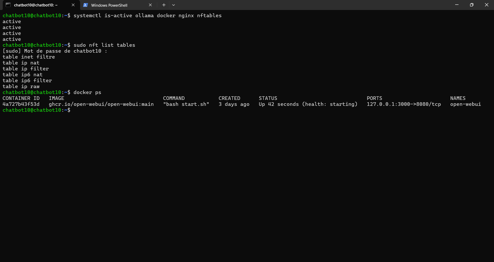{width=90%}

Les quatre services sont actifs, notre table `inet filtre` est rechargée à côté des tables créées par Docker, et le conteneur Open WebUI a été relancé automatiquement grâce à `--restart always`. 42 secondes après le démarrage, il est encore en `health: starting`, ce qui ne prouve pas encore que le chatbot remarche.

Nous avons donc refait un redémarrage en allant jusqu'au bout. Après environ une minute, le conteneur passe à `healthy` :

```bash
systemctl is-active ollama docker nginx nftables
# → active
# → active
# → active
# → active

docker ps
# → ... ghcr.io/open-webui/open-webui:main ... Up About a minute (healthy)   127.0.0.1:3000->8080/tcp   open-webui
```

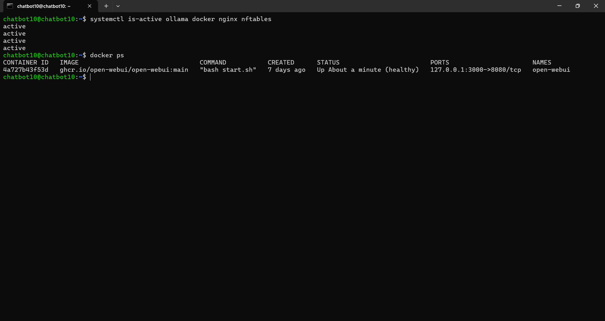{width=90%}

**Vérification (navigateur de l'hôte) :** après ce redémarrage, la question « Qu'est-ce qu'un reverse proxy ? » reçoit une réponse du modèle. Dans le menu de gauche, les conversations des jours précédents (« Belgium's Capital », « HTTPS basics », « Firewall Purpose »…) sont toujours là, donc l'historique enregistré dans le volume `open-webui` est conservé.

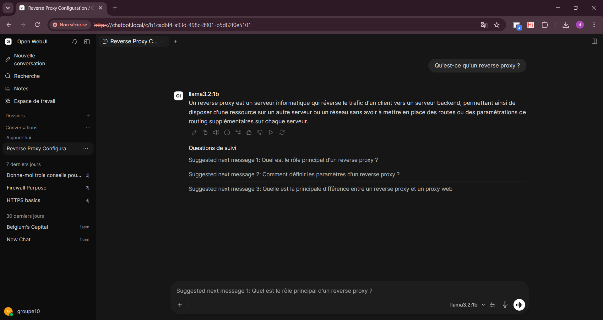{width=90%}

::: {.callout-tip}
**Snapshot conseillé :** le pare-feu est actif et survit au redémarrage, prendre le snapshot `05-firewall-ok`. C'est l'état final de la VM.
:::


## Vérification et tests

Les tests ci-dessous ont été réalisés sur la VM principale. Les deux tests obligatoires sont le **test de sécurité négatif** (n° 6) et le **test de panne** (n° 10).

Les tests 1 à 5, 8 et 9 ont été faits pendant l'installation, avec leurs captures : chaque ligne du tableau renvoie vers la section où le test est décrit. Les tests 6, 10 et 11 sont détaillés juste après le tableau.

### Tableau récapitulatif des tests

| # | Test | Commande / Action | Résultat attendu | Résultat obtenu | ✅/❌ |
|---|---|---|---|---|---|
| 1 | Le modèle répond en local (voir @sec-test-modele) | `ollama run llama3.2:1b "..."` puis `curl` sur l'API `/api/generate` | Une réponse du modèle | Réponse en ligne de commande, et JSON de l'API en 0,828 s | ✅ |
| 2 | Open WebUI joint Ollama (voir @sec-premier-acces) | Question dans l'interface, via le tunnel SSH | Le modèle apparaît et répond | « La réponse finale est Bruxelles. » | ✅ |
| 3 | HTTPS via Nginx (voir @sec-chatbot-local) | `curl.exe -kI https://chatbot.local/` | `200 OK`, `Server: nginx` | `HTTP/1.1 200 OK`, `Server: nginx` | ✅ |
| 4 | Redirection HTTP (voir @sec-chatbot-local) | `curl.exe -I http://chatbot.local/` | `301` vers HTTPS | `301 Moved Permanently`, `Location: https://chatbot.local/` | ✅ |
| 5 | Pas d'inscription libre (voir @sec-chatbot-local) | `https://chatbot.local` en navigation privée | Page de connexion seule | Page `/auth`, sans lien d'inscription | ✅ |
| 6 | **Sécurité négative** : Ollama inaccessible depuis l'hôte (voir @sec-test-securite) | `curl.exe --max-time 5 http://192.168.56.10:11434/` | Connexion bloquée | Avant le pare-feu : `Ollama is running`. Après : `Connection timed out` | ✅ |
| 7 | Port 3000 également filtré (voir @sec-test-securite) | `curl.exe --max-time 5 http://192.168.56.10:3000/` | Connexion bloquée | Avant : connexion refusée (déjà fermé par Docker). Après : `Connection timed out` | ✅ |
| 8 | Le conteneur joint toujours Ollama (voir @sec-pare-feu) | `docker exec open-webui curl -s http://host.docker.internal:11434` | `Ollama is running` | `Ollama is running`, et le chat répond dans le navigateur | ✅ |
| 9 | Redémarrage de la VM (voir @sec-reboot) | `sudo reboot`, puis `systemctl is-active`, `nft list tables`, `docker ps` | Tout redémarre seul | 4 × `active`, table `inet filtre` rechargée, conteneur `healthy`, le chat répond et l'historique est conservé | ✅ |
| 10 | **Panne simulée** (voir @sec-test-panne) | `docker stop open-webui`, puis `curl.exe -kI https://chatbot.local/` | Erreur `502` renvoyée par Nginx | `HTTP/1.1 502 Bad Gateway`, `Connection refused` dans le journal de Nginx, retour à la normale après `docker start` | ✅ |
| 11 | Fonctionnement hors ligne (voir @sec-test-hors-ligne) | Carte NAT débranchée, question dans le chat | Le chat répond sans Internet | `ping 8.8.8.8` : 100 % de perte, le modèle répond quand même | ✅ |

### Test 6 — Sécurité négative : Ollama inaccessible depuis le réseau {#sec-test-securite}

**Ce que le test valide :** un service interne ne doit pas être joignable depuis le réseau, même par quelqu'un qui connaît l'adresse de la VM. Comme Ollama n'a pas d'authentification, sans pare-feu n'importe quelle machine du réseau pourrait utiliser le modèle sans passer par Open WebUI.

**Depuis l'hôte (PowerShell), avant le pare-feu :**

```powershell
curl.exe --max-time 5 http://192.168.56.10:11434/
# → Ollama is running
```

**Depuis l'hôte (PowerShell), après le pare-feu :**

```powershell
curl.exe --max-time 5 http://192.168.56.10:11434/
# → curl: (28) Connection timed out after 5000 milliseconds

curl.exe --max-time 5 http://192.168.56.10:3000/
# → curl: (28) Connection timed out after 5000 milliseconds
```

Le port 11434 répondait avant le pare-feu et ne répond plus après : c'est la preuve que le pare-feu bloque l'accès direct à Ollama. Le seul chemin vers le chatbot reste `https://chatbot.local`, qui demande de se connecter.

Le port 3000 (test 7) échoue aussi, mais il était déjà fermé avant le pare-feu, puisque Docker ne le publie que sur `127.0.0.1`. Ce test montre seulement que le pare-feu ajoute une deuxième protection. Les captures se trouvent dans la partie sur le pare-feu (`05-avant` et `05-apres`).

### Test 10 — Panne simulée d'Open WebUI {#sec-test-panne}

**Ce que le test valide :** le comportement du système quand un composant tombe. On arrête le conteneur Open WebUI. Nginx doit rester en ligne et signaler clairement que le service derrière lui ne répond plus, puis tout doit revenir après un simple redémarrage du conteneur.

**Sur vm-chatbot :** arrêt du conteneur.

```bash
docker stop open-webui
# → open-webui

docker ps -a
# → 4a727b43f53d   ghcr.io/open-webui/open-webui:main   ...   Exited (137) 4 seconds ago   open-webui
# → d955dfe484f9   hello-world                          ...   Exited (0) 3 days ago        pensive_dubinsky
```

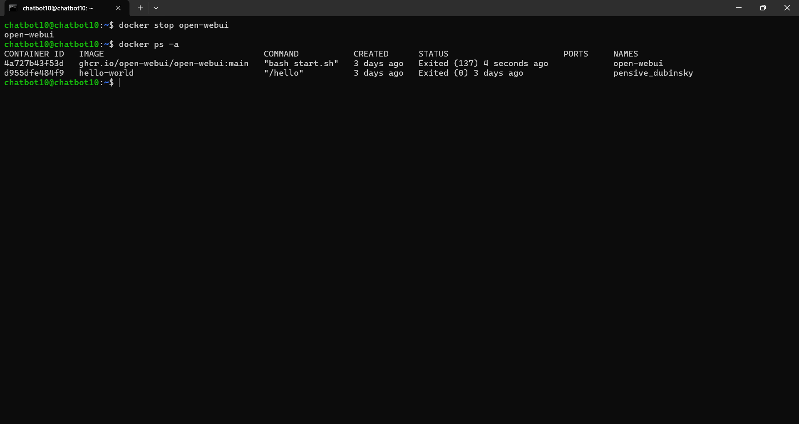{width=90%}

Le code `137` veut dire que le conteneur a été arrêté de force. `docker stop` envoie d'abord un signal d'arrêt propre, attend par défaut 10 secondes, puis tue le processus s'il tourne encore (137 = 128 + 9, le signal `SIGKILL`). Les données (comptes, conversations) sont dans le volume `open-webui` et pas dans le conteneur, mais un arrêt forcé peut quand même couper une écriture en cours. Il faut donc vérifier les données après coup, ce qu'on fait plus bas.

**Depuis l'hôte (PowerShell) :**

```powershell
curl.exe -kI https://chatbot.local/
# → HTTP/1.1 502 Bad Gateway
# → Server: nginx
# → Content-Type: text/html
```

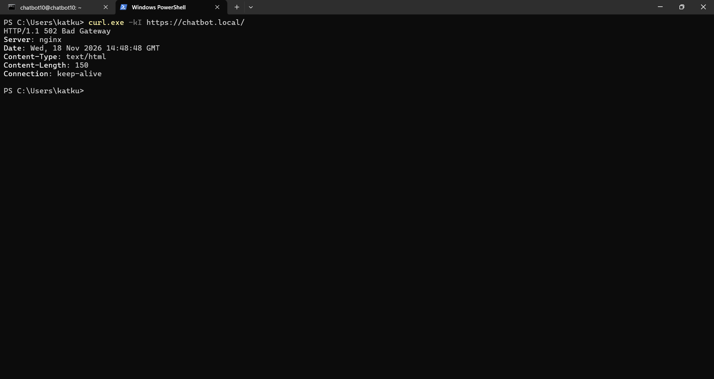{width=90%}

Dans le navigateur, la page affiche le message d'erreur de Nginx :

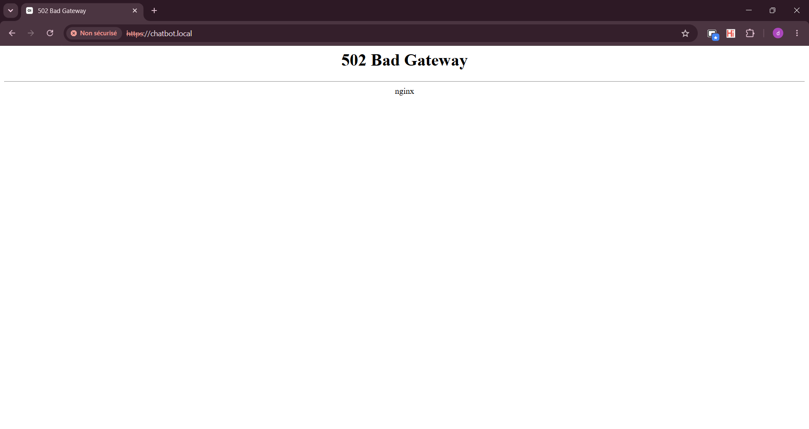{width=70%}

**Lecture du résultat :** la réponse vient bien de Nginx (`Server: nginx`), qui fonctionne toujours. Dans ce test, le 502 vient de l'arrêt du conteneur, puisque Nginx ne parvient plus à joindre `127.0.0.1:3000`.

Lors d'une seconde exécution du test, nous avons aussi consulté le journal d'erreurs de Nginx, qui le confirme directement :

```bash
sudo tail -n 2 /var/log/nginx/error.log
# → 2026/11/22 00:23:44 [error] 757#757: *380 connect() failed (111: Connection refused) while connecting
# →   to upstream, client: 192.168.56.1, server: chatbot.local,
# →   request: "GET /ws/socket.io/?EIO=4&transport=websocket HTTP/1.1",
# →   upstream: "http://127.0.0.1:3000/ws/socket.io/?EIO=4&transport=websocket", host: "chatbot.local"
# → 2026/11/22 00:23:50 [error] 757#757: *383 connect() failed (111: Connection refused) ...
```

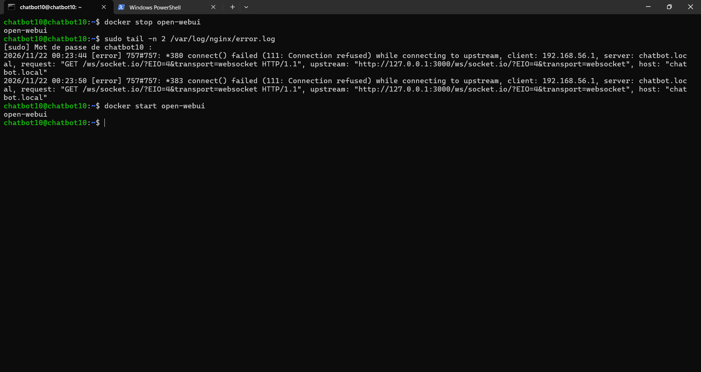{width=90%}

`Connection refused` montre que plus rien n'écoute sur `127.0.0.1:3000`. Ces lignes viennent de l'onglet du navigateur resté ouvert, qui essaie de rouvrir sa connexion WebSocket (`transport=websocket`) toutes les quelques secondes. C'est aussi la preuve que les WebSockets d'Open WebUI passent bien par Nginx.

**Remise en service (sur vm-chatbot) :**

```bash
docker start open-webui
# → open-webui
```

Après environ une minute de démarrage, `https://chatbot.local` affiche de nouveau l'interface, avec le modèle `llama3.2:1b` disponible et la session toujours ouverte. Les conversations créées avant l'arrêt forcé (« Belgium's Capital », « HTTPS basics », « Firewall Purpose ») sont toujours dans l'historique, comme le montre la capture prise après le redémarrage de la VM.

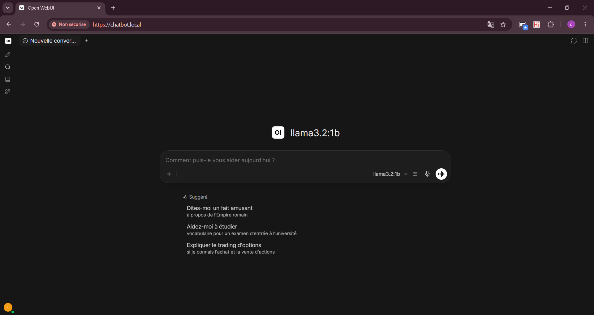{width=90%}

### Test 11 — Fonctionnement sans Internet {#sec-test-hors-ligne}

**Ce que le test valide :** le principe même du projet. Le modèle tourne sur la VM, donc une question posée au chatbot ne part vers aucun serveur extérieur. On coupe l'accès Internet de la VM en gardant le réseau host-only, et on vérifie que le chat répond toujours.

**Dans VirtualBox**, dans la fenêtre de la VM, on ouvre le menu **Périphériques → Réseau → Carte réseau 1** (NAT) et on décoche **Connecter le câble réseau**. La carte 2 (host-only) reste branchée.

**Vérification (sur vm-chatbot) :**

```bash
ping -c 2 8.8.8.8
# → 2 packets transmitted, 0 received, 100% packet loss, time 1034ms
```

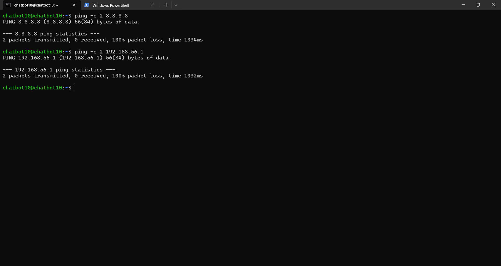{width=90%}

La VM ne joint plus Internet. Sur la même capture, le ping de la VM vers l'hôte (`192.168.56.1`) échoue aussi, mais pour une autre raison, car le pare-feu de Windows bloque par défaut les pings entrants. Le réseau host-only fonctionne toujours, puisque la session SSH reste active, et on le vérifie dans l'autre sens :

```powershell
# Depuis l'hôte (PowerShell)
ping 192.168.56.10
# → Réponse de 192.168.56.10 : octets=32 temps<1ms TTL=64
# → Paquets : envoyés = 4, reçus = 4, perdus = 0 (perte 0%)
```

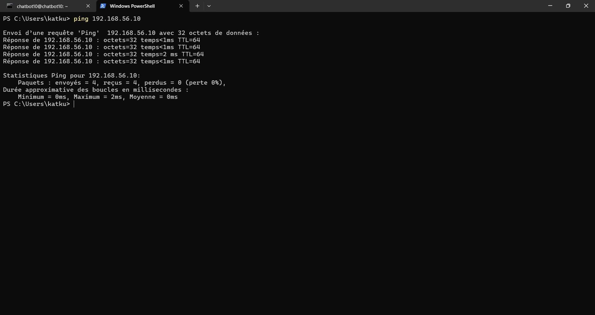{width=90%}

**Vérification (navigateur de l'hôte) :** sur `https://chatbot.local`, la question « Donne-moi trois conseils pour bien dormir. » reçoit une réponse complète en trois points, à 15 h 59, alors que la VM n'a plus accès à Internet.

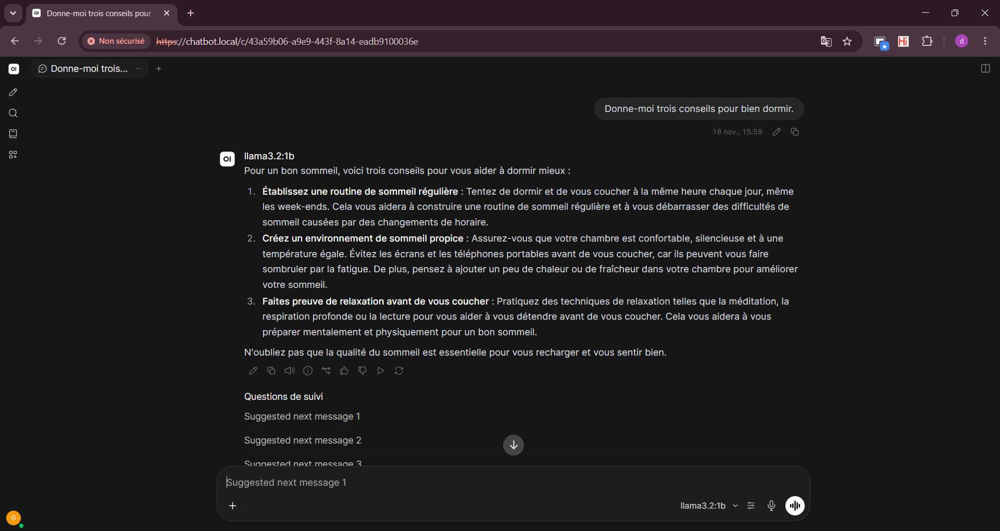{width=90%}

Après le test, la carte réseau 1 est rebranchée.


## Problèmes rencontrés

**1. Connexion SSH refusée : « REMOTE HOST IDENTIFICATION HAS CHANGED »**

*Symptôme :* depuis la machine hôte, `ping 192.168.56.10` répondait, mais `ssh chatbot10@192.168.56.10` affichait `WARNING: REMOTE HOST IDENTIFICATION HAS CHANGED!` puis `Host key verification failed.`, sans demander de mot de passe.

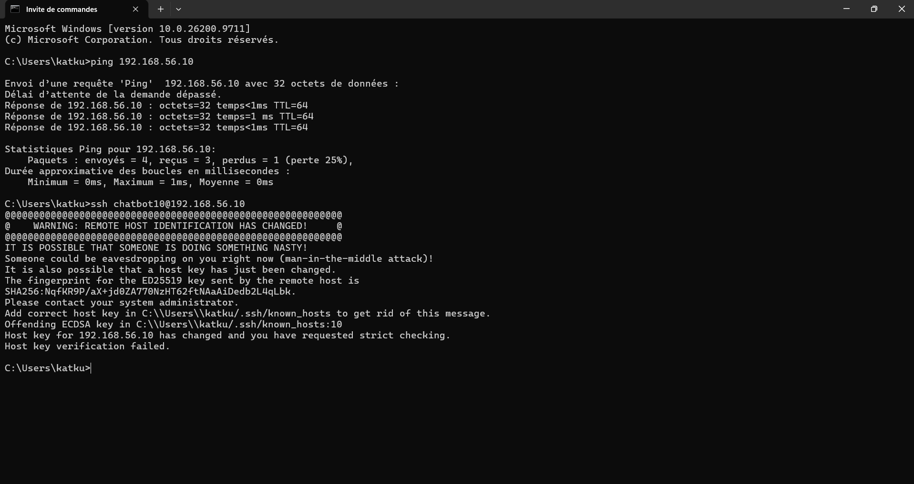{width=90%}

*Cause :* à la première connexion à une machine, le client SSH enregistre son empreinte dans le fichier `known_hosts` de la machine hôte, puis la compare à chaque connexion suivante. La machine hôte s'était déjà connectée à d'autres VMs qui utilisaient la même adresse `192.168.56.10`. Notre VM, dont le serveur SSH venait d'être installé, avait une empreinte différente, et SSH a bloqué la connexion, car une empreinte qui change peut signaler une usurpation d'identité.

*Solution :* comme le changement d'empreinte était attendu (nouvelle VM locale sur le réseau host-only), supprimer les anciennes empreintes enregistrées pour cette adresse, puis se reconnecter et accepter la nouvelle.

```powershell
# Sur la machine hôte
ssh-keygen -R 192.168.56.10
# → # Host 192.168.56.10 found: line 8
# → # Host 192.168.56.10 found: line 9
# → # Host 192.168.56.10 found: line 10
# → C:\Users\katku/.ssh/known_hosts updated.

ssh chatbot10@192.168.56.10
# → Are you sure you want to continue connecting (yes/no/[fingerprint])? yes
# → Warning: Permanently added '192.168.56.10' (ED25519) to the list of known hosts.
```

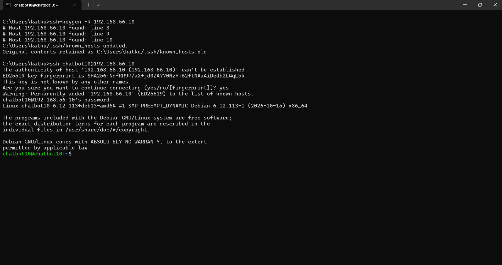{width=90%}

Avec le recul, il aurait fallu comparer la nouvelle empreinte avec celle de la VM **avant** de taper `yes`. Sinon, on retire le blocage sans savoir si on se connecte bien à la bonne machine. Nous l'avons vérifié après coup avec `ssh-keygen -lf /etc/ssh/ssh_host_ed25519_key.pub` dans la console de la VM. L'empreinte affichée (`SHA256:NqfKR9P/aX+jd0ZA77ONzHT62ftNAaAiDedb2L4qLbk`) est identique à celle acceptée ici. C'est cette vérification qui figure maintenant dans la procédure.

---

**2. `apt` bloqué après l'ajout du dépôt Docker : « Entrée 1 mal formée »**

*Symptôme :* pendant l'installation de Docker, `sudo apt update` s'arrêtait avec `Erreur : Entrée 1 mal formée dans list fichier /etc/apt/sources.list.d/docker.list (URI)` puis `Erreur : La liste des sources ne peut être lue.` Plus aucune commande `apt` ne fonctionnait.

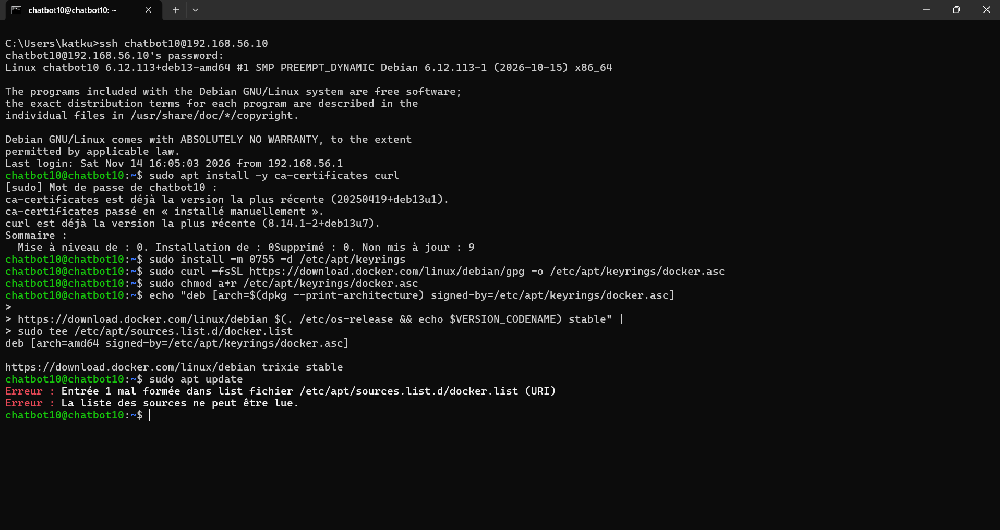{width=90%}

*Cause :* la commande qui écrit le fichier du dépôt tient sur une très longue ligne. Au moment du copier-coller, des retours à la ligne se sont glissés dedans. Les `>` visibles sur la capture sont l'invite de continuation de bash : le retour à la ligne s'est retrouvé entre les guillemets, donc dans le texte écrit dans `docker.list`. Le fichier `docker.list` a donc été écrit sur trois lignes, alors qu'`apt` exige qu'un dépôt tienne sur **une seule ligne**. La première ligne ne contenait pas d'adresse, d'où l'erreur « URI ».

*Solution :* réécrire le fichier en découpant la commande en lignes courtes, à l'aide de deux variables, puis vérifier son contenu avant de relancer `apt update`.

```bash
D="deb [arch=amd64 signed-by=/etc/apt/keyrings/docker.asc]"
U="https://download.docker.com/linux/debian trixie stable"
echo "$D $U" | sudo tee /etc/apt/sources.list.d/docker.list

cat /etc/apt/sources.list.d/docker.list
# → deb [arch=amd64 signed-by=/etc/apt/keyrings/docker.asc] https://download.docker.com/linux/debian trixie stable

sudo apt update
# → Réception de : 4 https://download.docker.com/linux/debian trixie InRelease [32,5 kB]
# → Réception de : 5 https://download.docker.com/linux/debian trixie/stable amd64 Packages [53,1 kB]
```

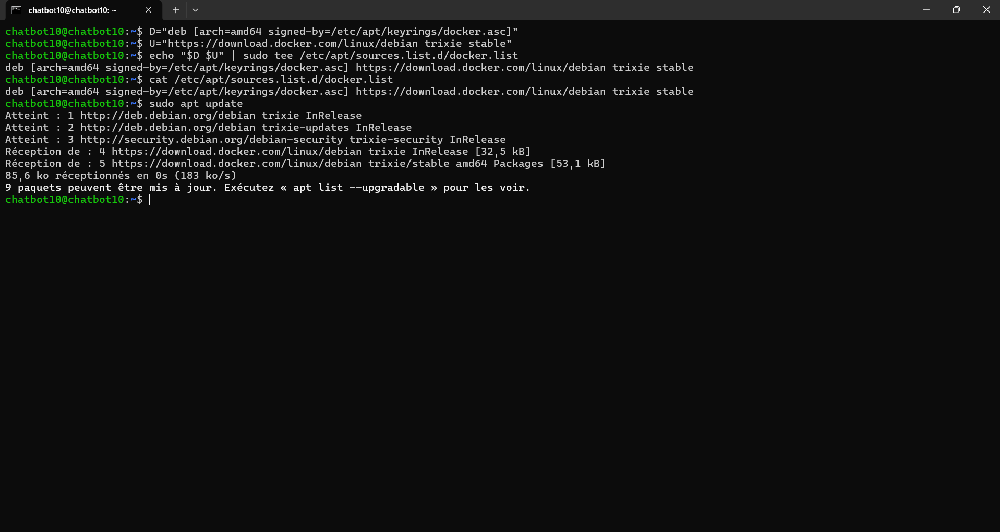{width=90%}

C'est cette version en lignes courtes qui figure dans la procédure d'installation, pour éviter le problème à la personne qui la reproduit.

---

**3. VM mise en pause pendant le téléchargement d'Open WebUI, à cause du disque plein de la machine hôte**

*Symptôme :* pendant le téléchargement de l'image Open WebUI, l'affichage s'est figé. Une nouvelle connexion SSH échouait avec `ssh: connect to host 192.168.56.10 port 22: Connection timed out`. Dans VirtualBox, la VM était en pause avec le message « Une erreur s'est produite pendant l'exécution de la machine virtuelle », dont le détail indiquait `VERR_DISK_FULL` (erreur non fatale).

{width=50%}

*Cause :* le disque virtuel de la VM est à allocation dynamique. Il est annoncé à 40 Gio, mais son fichier sur la machine hôte ne grossit qu'au fur et à mesure des écritures. Le modèle (1,3 Go), puis l'image Open WebUI (plusieurs Go) l'ont fait grossir jusqu'à remplir le disque de la **machine hôte**, et VirtualBox a mis la VM en pause parce qu'il ne pouvait plus écrire sur le disque de la machine hôte. Nous avions pourtant vérifié la place libre sur le PC d'Aya au départ, mais nous avions oublié qu'elle avait elle aussi refait toute l'installation sur sa copie de la VM. Il y avait donc deux VMs complètes sur le même disque, avec chacune son modèle et son image Docker. Le disque de la VM, lui, n'était pas plein, puisque `df -h /` montre 13 Go utilisés sur 38 Go (35 %) une fois l'installation terminée.

*Solution :* libérer de l'espace sur la machine hôte (désinstallation d'un logiciel volumineux, 26 Go libres ensuite), puis reprendre la VM en décochant **Machine → Pause** dans la fenêtre de la VM (c'est un interrupteur). La VM est repartie sans rien perdre, mais le téléchargement avait échoué entre-temps, le serveur ayant fermé la connexion pendant la pause :

```text
docker: failed to copy: read tcp 10.0.2.15:46138->185.199.108.154:443: read: connection reset by peer
```

{width=90%}

Il a suffi de relancer la même commande `docker run`, car Docker garde les couches déjà téléchargées et ne récupère que celles qui manquent. La leçon, c'est qu'avant d'installer, il faut vérifier l'espace libre sur la machine hôte, et pas seulement la taille du disque virtuel.


## Distribution des tâches

Nous avons d'abord créé la VM principale sur le PC d'Aya Janaâ, puis nous en avons partagé une copie entre nous, pour que tout le monde parte des mêmes réglages (nom de la VM, utilisateur, réseau). Sur les Mac de Narjis et Soumaya, la copie ne fonctionnait pas, et elles ont dû recréer la VM. Ensuite, chacune a suivi toutes les phases seule sur sa VM (configuration réseau, Ollama, Docker et Open WebUI, Nginx et HTTPS, pare-feu). Le but était que chacune découvre par elle-même comment faire, puis que l'on puisse comparer nos résultats et voir si on obtenait la même chose. L'installation documentée ici est celle de la VM principale, réalisée sur le PC d'Aya.

| Membre | Tâches réalisées |
|---|---|
| Narjis Ben Messoud Akasri | Recréation de la VM sur Mac (architecture ARM), ensemble des phases sur sa VM, comparaison des résultats et relecture |
| Zahra Hajji | Ensemble des phases sur sa copie de la VM, installation de la VM principale avec Aya Janaâ, rédaction du document |
| Ranya Houmaid | Ensemble des phases sur sa copie de la VM, comparaison des résultats et relecture |
| Aya Janaâ | Création et hébergement de la VM principale, installation de celle-ci avec Zahra Hajji, ensemble des phases sur sa propre copie de la VM |
| Soumaya Yousrani | Recréation de la VM sur Mac (architecture ARM), ensemble des phases sur sa VM, comparaison des résultats et relecture |


## Améliorations possibles

- **Des réponses plus rapides et de meilleure qualité.** C'est la limite la plus visible du projet. Sans carte graphique, le modèle tourne uniquement sur le processeur. La première réponse a pris plus d'une minute, le temps de charger le modèle en mémoire, et les suivantes s'affichent mot par mot, à environ 19 tokens par seconde sur une question courte. Les réponses restent aussi parfois approximatives en français, comme la définition d'un pare-feu donnée par le modèle. On voit plusieurs pistes, de la plus simple à la plus coûteuse.
    - **Garder le modèle en mémoire.** Par défaut, Ollama décharge le modèle après 5 minutes sans question, donc la question suivante doit attendre qu'il soit rechargé. La variable `OLLAMA_KEEP_ALIVE=-1`, ajoutée dans le même fichier de surcharge que `OLLAMA_HOST`, le garderait chargé en permanence, mais il occuperait 1 à 2 Go de RAM en continu.
    - **Donner plus de ressources à la VM.** La vitesse de génération dépend surtout du nombre de cœurs. Passer de 4 à 6 ou 8 processeurs virtuels accélérerait chaque réponse, dans la limite des cœurs physiques de la machine hôte.
    - **Passer à un modèle plus grand.** `llama3.2:3b` (environ 2 Go, 3 milliards de paramètres) répondrait mieux, surtout en français, mais plus lentement sur le même processeur. Nous ne l'avons pas testé, mais avec trois fois plus de paramètres, on peut s'attendre à des réponses environ deux à trois fois plus lentes. Avec Ollama, il suffit d'une commande (`ollama pull llama3.2:3b`) et le nouveau modèle apparaît directement dans la liste d'Open WebUI. On pourrait garder les deux et laisser l'utilisateur choisir entre rapidité et qualité.
    - **Utiliser une carte graphique.** VirtualBox ne donne pas accès au GPU de la machine hôte. Pour un vrai usage en entreprise, il faudrait installer Ollama sur une machine physique ou un serveur avec un GPU. Un GPU accélérerait fortement la génération, et on pourrait utiliser des modèles de 7 à 8 milliards de paramètres, beaucoup plus performants.
- **Un certificat reconnu par les navigateurs.** Let's Encrypt (via `certbot`) ne peut pas délivrer de certificat pour un nom local comme `chatbot.local`, il faudrait un vrai nom de domaine public. En réseau local, on pourrait créer une petite autorité de certification interne, signer le certificat de `chatbot.local` avec elle, puis l'installer comme autorité de confiance sur les postes des utilisateurs. L'avertissement du navigateur disparaîtrait.
- **Fixer la version d'Open WebUI.** L'image `open-webui:main` change à chaque nouvelle version, donc refaire l'installation plus tard pourrait donner une interface différente de celle documentée ici. On pourrait lancer l'image par son empreinte, déjà relevée lors du téléchargement : `ghcr.io/open-webui/open-webui@sha256:59b912d4246103c7285de0e9a5f2f6586614c06b4c4e46edc51a8f29e7b099a5`. On obtiendrait exactement la même image à chaque installation, et les mises à jour deviendraient un choix.
- **Sauvegarder le volume `open-webui`.** Les comptes et conversations sont dans ce volume. Une sauvegarde régulière, par exemple avec `docker run --rm -v open-webui:/data -v /home/chatbot10/sauvegardes:/backup debian tar czf /backup/openwebui.tar.gz -C /data .` lancé par un timer systemd, permettrait de les restaurer après une erreur, sans dépendre des snapshots.


## Utilisation de l'IA

Nous avons utilisé l'assistant Claude comme support tout au long du projet, pour nous expliquer les commandes et les fichiers de configuration, nous aider à diagnostiquer les problèmes, et mettre en forme ce document à partir de nos captures.

L'installation elle-même a été réalisée par le groupe. Chacune a fait toutes les phases sur sa VM, sur PC et sur Mac, puis nous avons comparé nos résultats. Toutes les sorties et captures de ce document viennent de la VM principale, et les problèmes décrits sont ceux que nous avons vraiment rencontrés.


## Conclusion

Nous avons mis en place un chatbot qui fonctionne entièrement en local. Le modèle `llama3.2:1b` tourne avec Ollama sur une VM Debian 13, l'interface Open WebUI est déployée dans un conteneur Docker, Nginx la rend accessible en HTTPS sous le nom `chatbot.local`, et un pare-feu nftables ne laisse entrer que SSH, HTTP et HTTPS depuis la machine hôte. Les tests montrent que tout redémarre seul, qu'une panne d'Open WebUI est clairement signalée, que les services internes ne sont pas joignables depuis le réseau, et que le chatbot répond même sans Internet.

Ce qui nous a surpris, c'est que nos vrais blocages ne venaient presque jamais du chatbot lui-même, mais de l'environnement, comme une empreinte SSH déjà enregistrée, une commande coupée par un copier-coller ou le disque du PC plein. Ce qui nous a demandé le plus de réflexion, c'est le réseau entre le conteneur et la VM. Dans un conteneur, `127.0.0.1` désigne le conteneur lui-même et pas la VM, et il a fallu comprendre `host.docker.internal` et l'interface `docker0`, puis en tenir compte dans le pare-feu.

On a aussi remarqué l'écart entre une infrastructure qui fonctionne correctement et un petit modèle qui reste lent sur processeur et dont les réponses sont parfois approximatives. Faire tourner un chatbot en local est donc tout à fait possible, mais pour un vrai usage, il faudrait une machine plus puissante.
